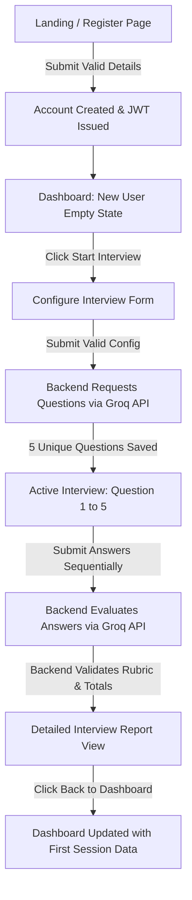
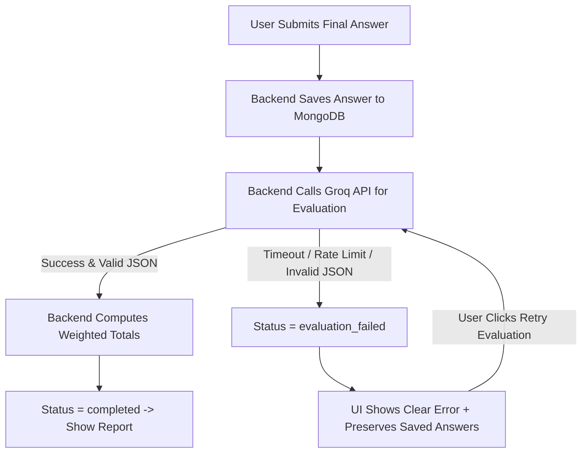
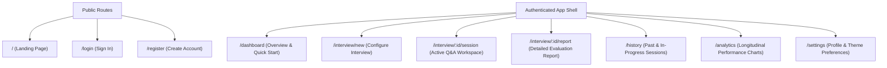

# `Career_AI_PRD.md` — Product Requirements Document

---

# PART 1 — PRODUCT FOUNDATION

## 1. Document Information

| Attribute | Details |
| :--- | :--- |
| **Document Title** | Career AI — Product Requirements Document (PRD) |
| **Product Name** | Career AI |
| **Product Type** | AI-Powered Mock Interview and Performance Analysis Web Application |
| **Document Version** | 1.0 (Implementation-Ready Baseline) |
| **Date** | October 17, 2026 |
| **Target Academic/Engineering Level** | Bachelor of Computer Applications (BCA) Capstone / Production-Grade Student SaaS |
| **Core Technology Stack** | JavaScript MERN Stack (MongoDB Atlas, Express.js, React 19 + Vite, Node.js) + Groq API |
| **Status** | Approved for Specification Review (No Code Implementation Started) |

---

## 2. Executive Summary

**Career AI** is a web-based mock interview and performance analysis platform built for college students, fresh graduates, and entry-level job seekers. Users configure personalized text-based interview sessions by selecting their target job role, experience level, interview category, difficulty level, and question count. Using the **Groq API** on the backend, the platform dynamically generates relevant interview questions, guides the candidate through a sequential question-and-answer workflow, and evaluates every submitted response against a transparent **100-point weighted rubric**.

Unlike static question banks or unstructured chat interfaces, Career AI enforces a structured preparation loop: **Configure → Practice → Evaluate → Review → Track**. It delivers criterion-level scores, strengths, weaknesses, suggested improved answers, and longitudinal analytics inside a responsive SaaS interface with full light and dark theme support—while keeping the architecture clean, monolithic, and fully explainable by a BCA student during an academic viva.

---

## 3. Product Vision

To provide an accessible, structured, and commercial-grade interview preparation workspace that empowers students and early-career candidates to practice role-specific interviews, understand specific gaps in their responses through transparent AI feedback, and track measurable progress across practice sessions.

---

## 4. Problem Statement

Students and entry-level candidates preparing for campus placements and initial career roles face four recurring obstacles:

1. **Lack of Realistic, Role-Specific Practice:** Generic lists of top interview questions do not adapt to the combination of a candidate's target role, experience level, and difficulty tier.
2. **Absence of Structured Feedback:** When practicing alone, candidates cannot objectively judge whether their answers are technically accurate, relevant to the prompt, clearly structured, or complete.
3. **No Rewrite Reference:** Knowing an answer is weak does not teach a student how to phrase a strong answer. Candidates need concrete examples of improved responses.
4. **No Longitudinal Visibility:** Without persistent session history and criterion-level analytics, candidates cannot tell whether their technical accuracy or communication clarity is improving over multiple practice sessions.

> **Important Disclaimer:** Career AI provides AI-generated interview preparation guidance and practice telemetry. Its scores and feedback represent heuristic educational assessments and must never be presented as scientifically validated psychometric measurements or guarantees of employment.

---

## 5. Product Goals

Each product goal is paired with its associated functional scope and measurable acceptance criteria.

| Goal ID | Product Goal | Associated Requirement IDs | Measurable Acceptance Criteria |
| :--- | :--- | :--- | :--- |
| **GOAL 1** | Allow users to create an account and securely access their personal interview preparation workspace. | `AUTH-001` to `AUTH-006`, `SEC-001`, `SEC-002` | 100% of protected routes and API endpoints reject unauthenticated requests with HTTP `401`; passwords are stored exclusively as `bcryptjs` hashes; users can register, log in, persist sessions across refreshes, and log out. |
| **GOAL 2** | Allow users to configure mock interviews according to their target role, experience level, interview category, difficulty, and question count. | `INT-001` to `INT-003` | The setup form enforces validation on all 5 required fields; invalid or incomplete submissions are blocked on both client and server with field-level error messages. |
| **GOAL 3** | Generate relevant interview questions using the Groq API. | `AI-001` to `AI-004`, `SEC-003` | Backend requests to Groq return the exact requested count (5, 10, or 15) of unique, role-aligned questions in validated JSON format without exposing the Groq API key to the browser. |
| **GOAL 4** | Allow users to answer questions through a sequential text-based interview experience. | `ACT-001` to `ACT-004` | Users progress sequentially from Question `1` to Question `N`, see real-time progress indicators, cannot submit empty answers or duplicate requests, and retain typed text if a network submission fails. |
| **GOAL 5** | Evaluate submitted answers using a transparent and consistent scoring rubric. | `EVAL-001` to `EVAL-005` | Every evaluated answer receives validated integer/decimal sub-scores across 4 weighted criteria (Technical Accuracy: 40, Relevance: 25, Clarity & Communication: 20, Completeness: 15), and the backend independently computes the sum (0 to 100). |
| **GOAL 6** | Provide actionable feedback, strengths, weaknesses, and suggested improvements. | `EVAL-003`, `REPORT-001` | Each evaluated question displays criterion scores, concise overall feedback, bulleted strengths, areas for improvement, a suggested improved answer, and recommended practice topics. |
| **GOAL 7** | Save interview sessions and results so users can review their previous work. | `HIST-001` to `HIST-003`, `REPORT-002` | Completed and in-progress interviews persist in MongoDB Atlas scoped to the authenticated `userId` and remain retrievable across logins. |
| **GOAL 8** | Display meaningful performance analytics based on actual stored results. | `DASH-001` to `DASH-004`, `ANALYTICS-001` to `ANALYTICS-004` | All charts and KPI cards compute values strictly from the logged-in user's completed interviews; zero-data or single-session states display honest empty states without fabricated trends. |
| **GOAL 9** | Provide an attractive, responsive, premium SaaS interface with fully functional dark and light themes. | `THEME-001` to `THEME-003` | Users can toggle between Light and Dark themes from navigation/settings; theme choice persists in `localStorage` (and optionally user profile); all views render cleanly from `360px` mobile to `1440px+` desktop viewports. |
| **GOAL 10** | Keep the implementation sufficiently simple that a BCA student can understand, maintain, demonstrate, and explain it during a college viva. | Architectural & Codebase Constraints | The project uses a standard two-folder JavaScript MERN repository (`client/` and `server/`), relies on standard REST APIs and Mongoose schemas, and avoids microservices, TypeScript, or complex build pipelines. |

---

## 6. Non-Goals

Career AI explicitly **does not** aim to:
1. Replace human interviewers or provide legally defensible hiring assessments.
2. Predict whether a specific company will hire a user.
3. Evaluate non-verbal body language, eye contact, voice pitch, or facial micro-expressions.
4. Act as a coding judge or remote code execution sandbox (answers are text-based explanations and conceptual/code-snippet responses evaluated by LLM rubric).
5. Serve as a two-sided recruitment marketplace connecting employers and candidates.

---

## 7. Scope and Boundaries

### A. Core Requirements (In Scope for v1.0)
* User registration, login, logout, and JWT-protected session management.
* Protected frontend routes and backend REST endpoints enforcing resource ownership.
* Personalized Dashboard displaying real user KPIs, recent sessions, quick-start category cards, and conditional empty states.
* Interview Configuration form (Target Job Role, Experience Level, Category, Difficulty, Question Count: 5, 10, or 15).
* Server-side Groq API question generation with JSON schema validation and duplicate filtering.
* Sequential text-based Active Interview session interface with progress bar, draft preservation on error, and step-by-step persistence.
* AI-powered answer evaluation using the mandatory 4-criterion 100-point rubric (`40 / 25 / 20 / 15`) with backend score verification.
* Comprehensive Interview Result Report with overall score, criterion breakdown, question-by-question feedback, strengths, weaknesses, suggested improved answers, and topics to practice.
* Interview History page with status indicators (`Completed`, `In Progress`, `Evaluation Failed`), sorting, and category filtering.
* Performance Analytics page powered by Recharts (Score Progression, Criterion Radar/Bar Comparison, Category Breakdown, Recurring Improvement Topics).
* Profile & Settings page (name update, read-only email/account metadata, persistent theme selector, logout).
* Global Light and Dark theme system.
* Explicit loading skeletons, empty states, success notifications, and recoverable error states across all workflows.

### B. Optional Future Enhancements (Post-v1.0 Only)
* Voice-to-text answer input using the browser Web Speech API.
* Text-to-speech audio playback for interview questions.
* PDF Resume upload to auto-suggest target roles and questions.
* Client-side PDF export of completed interview reports.
* Custom study plan scheduling based on weak topics.
* Support for fallback LLM providers (e.g., Gemini or OpenAI) alongside Groq.

*Boundary Rule:* None of the Optional Future Enhancements may be built until 100% of Core Requirements pass acceptance testing.

### C. Out of Scope (Strictly Excluded)
* Real-time WebRTC video streaming or webcam recording infrastructure.
* Facial emotion detection or AI personality/psychological diagnosis.
* Automated job application bots or job board scraping.
* Employer/Recruiter multi-tenant dashboards or candidate pipelines.
* Payment gateways (Stripe/Razorpay) or subscription billing tiers.
* Microservices, message queues (Kafka/RabbitMQ), Docker orchestration, or separate Java/Spring Boot backends.

---

## 8. Assumptions and Constraints

To maintain transparency, requirements are classified into four categories:

### 8.1 Confirmed Product Requirements
* The application is a pure **JavaScript (ES6+ / JSX) MERN stack** web application.
* **TypeScript (`.ts`/`.tsx`), Next.js, Java/Spring Boot, PostgreSQL, Prisma, and GraphQL are strictly prohibited.**
* All AI operations use the **Groq API** invoked exclusively from the Node.js/Express backend.
* Answer grading follows the fixed 100-point rubric: Technical Accuracy (40), Relevance (25), Clarity and Communication (20), Completeness (15).
* Both Light and Dark themes are mandatory across all pages and components.

### 8.2 Reasonable Assumptions
* Users have a modern web browser (Chrome, Edge, Firefox, Safari) and an active internet connection.
* A valid Groq API key with sufficient free or developer rate-limit quota is configured in the backend `.env` file.
* MongoDB Atlas free/shared cluster storage (512 MB) is more than sufficient for storing text transcripts and JSON evaluations for a student demonstration and early user base.

### 8.3 Proposed Decisions (Labeled Proposals for Implementation Simplicity)
* **Proposal 1 — Batch Evaluation Upon Interview Completion (with Per-Answer Fallback):** Answers are saved immediately to MongoDB as the user progresses from question to question (`In Progress` state). Final AI evaluation is triggered when the user submits the final question (or clicks "Complete & Evaluate"). *Rationale:* Evaluating all 5–15 answers at completion (either via a structured batch prompt or controlled sequential server calls) makes the active interview transition instantaneous between questions and avoids mid-interview Groq rate-limit interruptions.
* **Proposal 2 — Embedded Document Schema:** Questions, user answers, and per-question evaluations are embedded directly as an array of subdocuments inside each `Interview` document in MongoDB rather than normalized across 3 separate collections. *Rationale:* An interview has at most 15 questions; embedding keeps MongoDB queries fast, atomic, and easy for a BCA student to explain without complex `$lookup` joins.
* **Proposal 3 — Configurable Groq Model Environment Variable:** Set `GROQ_MODEL` in `server/.env` (defaulting to a fast, structured-output-capable model such as `llama-3.3-70b-versatile` or `llama-3.1-8b-instant`) so the model can be changed via configuration without modifying code if Groq deprecates a model ID.

### 8.4 Open Questions
* See **Section 51 (Open Questions)** for items regarding token expiration duration, rate-limit thresholds, and whether incomplete interviews can be abandoned/deleted by the user.

---

# PART 2 — USERS AND EXPERIENCE

## 9. Target Users

Career AI serves individuals preparing for structured job interviews who need guided practice and objective feedback:
1. **Undergraduate Students (BCA, B.Sc. IT, B.Tech, MCA):** Preparing for campus placement drives.
2. **Fresh Graduates:** Transitioning from academics to their first software, IT support, analyst, or business role.
3. **Entry-Level Job Seekers (0–2 Years Experience):** Practicing role-specific technical and behavioral interviews to switch jobs or re-enter the workforce.

---

## 10. User Personas

### Persona A: Aarav Sharma — Final-Year BCA Student
* **Background:** 20-year-old final-year BCA student preparing for campus placements in software development and IT services companies. Comfortable with basic programming (JavaScript, Java, SQL, HTML/CSS) but nervous during formal interviews.
* **Primary Goals:** Practice both Technical and HR questions for "Fresher" roles; learn how to structure clear answers instead of giving one-line definitions.
* **Main Challenges:** Freezes when asked follow-up or scenario questions; doesn't know if his explanation of DBMS normalization or React state is complete enough for an interviewer.
* **Expected Features:** Beginner/Intermediate difficulty presets, HR + Technical categories, side-by-side comparison of his answer vs. a suggested improved answer, and a list of weak topics to revise before placement week.
* **Typical Usage Scenario:** Completes two 5-question practice sessions every evening—one Technical ("Frontend Developer - Fresher") and one HR—then reviews the suggested improved answers.
* **What Success Looks Like:** His average score improves from the 50s to 75+ over two weeks, and he stops omitting key examples in his responses.

### Persona B: Priya Nair — Fresh Graduate
* **Background:** Recently graduated with a computer applications degree and applying off-campus for Junior Full-Stack Developer and QA Analyst roles.
* **Primary Goals:** Benchmark her readiness across different job titles and identify whether her weakness lies in technical accuracy or communication clarity.
* **Main Challenges:** Receives rejection emails after first-round interviews without feedback on why her answers fell short.
* **Expected Features:** Role-specific question generation, criterion-level score breakdowns (seeing Technical Accuracy separately from Clarity), and historical score tracking.
* **Typical Usage Scenario:** Configures a 10-question Intermediate interview for "Junior MERN Stack Developer", completes the session, and checks the Analytics page to compare her criterion averages.
* **What Success Looks Like:** Pinpoints that her Technical Accuracy is high (34/40) but Completeness is low (7/15), allowing her to focus on giving more thorough explanations.

### Persona C:ohan Verma — Entry-Level Job Seeker
* **Background:** Has 1 year of internship/junior support experience and is targeting an Entry-Level Backend Engineer or Business Analyst position.
* **Primary Goals:** Practice Behavioral and Role-Based scenario questions at Intermediate and Advanced difficulty levels and maintain a consistent practice log.
* **Main Challenges:** Struggles to keep answers focused and relevant when asked open-ended behavioral questions ("Tell me about a time you handled a tight deadline").
* **Expected Features:** Behavioral and Role-Based categories, Relevance and Clarity scoring, and an organized Interview History archive to revisit past sessions before real interviews.
* **Typical Usage Scenario:** Filters his Interview History by "Behavioral" category two hours before a scheduled interview to review his past mistakes and improved answer templates.
* **What Success Looks Like:** Builds a personal library of completed mock sessions with clear, repeatable answer structures.

---

## 11. User Needs

| User Need ID | Need Statement | Product Feature Mapping |
| :--- | :--- | :--- |
| **NEED-01** | "I need questions tailored to my exact target job title and experience level." | Interview Configuration (`INT-001`) + Groq Prompt Builder (`AI-001`) |
| **NEED-02** | "I need a distraction-free environment to answer one question at a time." | Active Interview View (`ACT-001` to `ACT-004`) |
| **NEED-03** | "I need to know *why* my answer got a specific score, not just a random number." | 4-Criterion Weighted Rubric (`EVAL-001`) + Criterion Breakdown (`REPORT-001`) |
| **NEED-04** | "I need to see what a strong answer looks like so I can learn how to improve." | Suggested Improved Answer (`EVAL-003`) |
| **NEED-05** | "I need to resume or retry if my internet drops or the AI times out." | Draft Persistence & Evaluation Retry (`ACT-003`, `ERR-002`) |
| **NEED-06** | "I need to see if my scores are actually improving over multiple sessions." | Dashboard & Analytics Charts (`DASH-002`, `ANALYTICS-001` to `ANALYTICS-004`) |

---

## 12. User Journeys

### User Journey 1: First-Time User (Registration to First Report)
* **Entry Point:** Public Landing Page (`/`) or Register Page (`/register`).
* **User Actions:** Clicks "Get Started" → Submits Name, Email, Password → Lands on empty Dashboard → Clicks "Start First Interview" → Selects Role ("Frontend Developer"), Level ("Fresher"), Category ("Technical"), Difficulty ("Beginner"), Count (`5`) → Answers all 5 questions sequentially → Submits final answer for evaluation → Reviews Report → Returns to Dashboard.
* **System Responses:** Validates registration → Hashes password & issues JWT → Renders new-user empty state on Dashboard → Validates config → Calls Groq API to generate 5 questions → Saves `in_progress` interview in MongoDB → Saves each submitted answer → Calls Groq API to evaluate answers → Validates rubric scores & calculates totals → Updates status to `completed` → Renders Report & updates Dashboard metrics.
* **Validation Requirements:** Valid email format, password at least 8 characters, unique email, non-empty configuration fields, non-empty answer text (minimum 10 characters recommended to prevent accidental blank clicks).
* **Possible Errors:** Duplicate email (`409`), Groq question generation timeout (`503`), evaluation failure (`502`).
* **Successful Completion Conditions:** Interview status is `completed`, all 5 questions have validated criterion scores and feedback, and Dashboard shows `1` completed interview.



### User Journey 2: Returning User (Review & Practice Loop)
* **Entry Point:** Login Page (`/login`) or auto-authenticated Dashboard (`/dashboard`).
* **User Actions:** Logs in → Reviews KPI cards and recent score progression on Dashboard → Clicks "Start New Interview" (or selects a quick category card) → Completes interview → Views Report → Navigates to Analytics (`/analytics`) to compare new score with historical average.
* **System Responses:** Verifies credentials → Loads stored interviews for `userId` → Computes real-time KPI aggregates → Executes new interview lifecycle → Appends new session to historical charts.
* **Validation Requirements:** Valid JWT token, active user record, minimum 2 completed sessions required before rendering trend delta lines.
* **Possible Errors:** Invalid credentials (`401`), expired JWT (`401` redirect to login).
* **Successful Completion Conditions:** New session is appended to user history and analytics reflect updated averages without page reload issues.

### User Journey 3: Review Previous Interview
* **Entry Point:** Authenticated Sidebar → Interview History (`/history`).
* **User Actions:** Opens Interview History → Optionally filters by Category or Status → Clicks "View Report" on a completed session (or "Resume" on an in-progress session) → Expands individual questions to inspect submitted answer vs. suggested improved answer and practice topics.
* **System Responses:** Queries MongoDB for interviews belonging to `req.user.id` sorted by `createdAt` descending → Verifies ownership on `/api/interviews/:id` → Renders complete stored report without re-calling the Groq API.
* **Validation Requirements:** Requested `interviewId` must be a valid MongoDB ObjectId and its `userId` must match the authenticated requester.
* **Possible Errors:** Interview not found (`404`), unauthorized cross-user access attempt (`403` or `404`).
* **Successful Completion Conditions:** Full historical report loads from MongoDB in under 1 second with zero AI token cost.

### User Journey 4: AI Failure & Recovery
* **Entry Point:** Interview Configuration submission or Final Answer Evaluation trigger.
* **User Actions:** Submits interview configuration OR finishes answering all questions and clicks "Evaluate Interview" → Experiences an AI error → Clicks "Retry".
* **System Responses:**
  * *Case A (Question Generation Fails):* Backend catches Groq timeout/rate-limit/malformed JSON → Does not create a corrupted interview record → Returns structured error (`503`) → Frontend preserves all form selections on `/interview/new` and displays a retry banner.
  * *Case B (Evaluation Fails):* User's submitted answers are already persisted in MongoDB with status `evaluation_failed` (or `in_progress` with all answers saved) → Backend returns structured error → Frontend displays a "Saved Safely — Retry Evaluation" panel → Clicking "Retry Evaluation" re-runs only the evaluation step using the saved answers.
* **Validation Requirements:** All user answers must be committed to MongoDB *before* invoking the final AI evaluation call.
* **Possible Errors:** Groq HTTP `429` (Rate Limit), HTTP `500/503` (Service Unavailable), Network Timeout, Invalid JSON from LLM.
* **Successful Completion Conditions:** Zero loss of user-typed answers; subsequent retry transitions interview to `completed` and displays the report.



### User Journey 5: New User With No Data
* **Entry Point:** Authenticated Dashboard (`/dashboard`), History (`/history`), or Analytics (`/analytics`) with `0` completed interviews.
* **User Actions:** Logs in for the first time and navigates across Dashboard, History, and Analytics.
* **System Responses:** Detects `completedInterviewsCount === 0` → Suppresses empty/broken charts and `NaN%` labels → Renders a tailored Empty State card explaining how Career AI works with a prominent primary CTA button ("Configure Your First Mock Interview").
* **Validation Requirements:** Frontend must never display hardcoded placeholder numbers (like `85% Average Score`) as real user metrics.
* **Possible Errors:** Network error fetching initial profile/summary (`500`).
* **Successful Completion Conditions:** User clearly understands they have no completed sessions yet and can launch `/interview/new` in one click.

---

## 13. Information Architecture



---

## 14. Navigation Requirements

1. **Public Navigation Header:** Displays brand logo ("Career AI"), theme toggle button (Light/Dark), "Log In" link, and "Get Started" primary button.
2. **Authenticated Application Shell:**
   * **Desktop (`1024px` and wider):** Fixed left sidebar (`240px–260px` width) containing Brand Logo, primary navigation links (*Dashboard*, *New Interview*, *Interview History*, *Analytics*, *Profile & Settings*), theme switcher, and user profile summary with Logout trigger.
   * **Mobile & Tablet (under `1024px`):** Sticky top bar with Brand Logo, theme toggle, and hamburger trigger opening an accessible slide-out drawer (`shadcn/ui Sheet`) or bottom navigation bar for primary routes.
3. **Active Interview Focus Mode:** When inside `/interview/:id/session`, navigation links away from the session prompt a confirmation dialog if the user has unsaved text in the current answer box, preventing accidental data loss.
4. **Active Route Highlighting:** The current route in the sidebar must display a clear visual active state (accent background fill, border indicator, and high-contrast label).

---

## 15. Page-by-Page Requirements

| Page Name & Route | Primary Purpose | Key UI Sections & Components | Allowed User Actions |
| :--- | :--- | :--- | :--- |
| **Landing Page** (`/`) | Explain value proposition and convert visitors. | Hero section, 4-Criterion Rubric explainer, How-It-Works 3-step visual, Feature grid, Footer. | Toggle theme, navigate to Login or Register (or Dashboard if already logged in). |
| **Login Page** (`/login`) | Authenticate existing users. | Email input, Password input with show/hide toggle, Submit button, error alert banner, link to `/register`. | Submit credentials, view validation errors, navigate to registration. |
| **Register Page** (`/register`) | Onboard new users. | Full Name, Email, Password, Confirm Password inputs, Submit button, link to `/login`. | Create account, view field-level validation rules. |
| **Dashboard** (`/dashboard`) | Central command center showing real KPIs and next steps. | Personalized greeting, Primary "Start Interview" CTA, 4 KPI Stat Cards, Score Trend Chart, Category Quick-Start cards, Recent Interviews list (top 5), Recurring Focus Areas card. | Start a new interview (blank or pre-filled category), open a recent report, resume an in-progress interview. |
| **Configure Interview** (`/interview/new`) | Collect parameters to generate a tailored mock interview. | Role text input + popular role chips, Experience Level selector, Category cards, Difficulty pills, Question Count selector (`5`, `10`, `15`), summary preview, "Generate Interview" button with loading state. | Fill parameters, submit configuration, retry if AI generation fails. |
| **Active Interview** (`/interview/:id/session`) | Sequential question answering workspace. | Top progress bar (`Question X of N`), Question metadata badges (Role, Category, Difficulty), Current Question card, Auto-expanding Answer Textarea with character/word count, "Save & Next Question" / "Submit & Evaluate" button, Question stepper indicator. | Type answer, submit current answer, retry failed network request, trigger final evaluation. |
| **Interview Report** (`/interview/:id/report`) | Present comprehensive scoring and question-level feedback. | Report header (Role, Date, Badges), Overall Score ring/card (`0–100`), 4 Criterion Progress Bars (`40/25/20/15`), Executive Summary (Strengths, Weaknesses, Practice Topics), Accordion/Cards for every Question (Question text, User Answer, Criterion breakdown, Feedback, Suggested Improved Answer), "Practice Again" CTA. | Expand/collapse question details, copy suggested answer for study, start a follow-up interview. |
| **Interview History** (`/history`) | Browse and manage all past and incomplete sessions. | Filter bar (Category dropdown, Status filter: All / Completed / In Progress / Failed, Sort by Date or Score), Session list/table with badges, Empty state. | Filter sessions, open completed reports, resume `in_progress` sessions, retry `evaluation_failed` sessions. |
| **Analytics** (`/analytics`) | Visualize longitudinal skill trends. | Summary KPI row, Score Progression Line/Area Chart, Criterion Mastery Bar Chart (`%` of max points per criterion), Category Distribution Chart, Top Recommended Practice Topics list. | Inspect chart tooltips, understand performance breakdowns across criteria and categories. |
| **Profile & Settings** (`/settings`) | Manage basic account details and theme preference. | Profile form (Editable Name, Read-only Email & Join Date), Appearance card (Light / Dark mode selector), Account Actions card (Logout button). | Update display name, switch theme, log out. |

---

# PART 3 — FUNCTIONAL REQUIREMENTS

> **Priority Legend:**  
> * **P0:** Essential for the application to function correctly (Launch Blocker).  
> * **P1:** Important for the complete product experience.  
> * **P2:** Optional enhancement within v1 polish.

---

## 16. Authentication (`AUTH`)

* **Scope Covered:** User registration, email/password validation, duplicate email handling, `bcryptjs` password hashing, user login, invalid credentials, JWT persistence, logout, protected frontend routes, protected backend endpoints, session expiration, safe error messages, and resource ownership.

| ID | Name | Description & Actor | Preconditions & Postconditions | Priority | Testable Acceptance Criteria |
| :--- | :--- | :--- | :--- | :--- | :--- |
| **AUTH-001** | User Registration | **Actor:** Guest User / System.<br>Allows a new user to create an account with Name, Email, and Password. | **Pre:** User is on `/register`.<br>**Post:** User record is saved in MongoDB with hashed password; JWT is issued. | **P0** | 1. Submitting a valid name (2–60 chars), valid email format, and password (at least 8 chars) creates a user in MongoDB with a `bcryptjs` hash (work factor at least 10) and returns HTTP `201`.<br>2. Plaintext password is never written to the database or returned in API responses. |
| **AUTH-002** | Duplicate Email & Input Validation | **Actor:** System.<br>Prevents duplicate accounts and malformed registration payloads. | **Pre:** Registration request submitted.<br>**Post:** Request rejected if invalid or email already exists. | **P0** | 1. Registering with an existing email (case-insensitive, trimmed) returns HTTP `409` with message `"An account with this email already exists."`<br>2. Missing fields or passwords under 8 characters are blocked by client validation (Zod) and rejected by server validation with HTTP `400`. |
| **AUTH-003** | User Login & Safe Error Handling | **Actor:** Registered User / System.<br>Authenticates user via Email and Password. | **Pre:** User exists in DB.<br>**Post:** Valid JWT token and sanitized user profile returned. | **P0** | 1. Valid credentials return HTTP `200` with JWT and `{ id, name, email, themePreference }`.<br>2. Unregistered email OR wrong password both return HTTP `401` with the exact same generic message (`"Invalid email or password"`) to prevent user enumeration. |
| **AUTH-004** | Authentication Persistence & Expiration | **Actor:** Authenticated User / System.<br>Persists login state across page reloads and handles expired tokens gracefully. | **Pre:** User has logged in.<br>**Post:** Session restores on refresh or redirects cleanly on token expiry. | **P0** | 1. Reloading any protected route restores user context via `/api/auth/me` using the stored JWT.<br>2. If a JWT is expired or tampered with, the backend returns HTTP `401`, the client clears stored auth state, and redirects to `/login` with a notification. |
| **AUTH-005** | User Logout | **Actor:** Authenticated User.<br>Terminates the active session on the client. | **Pre:** User is logged in.<br>**Post:** Auth token and cached user data are purged; user redirected to `/login`. | **P0** | Clicking "Log Out" removes the JWT from browser storage, resets React auth context, and prevents accessing `/dashboard` via the browser Back button without logging in again. |
| **AUTH-006** | Route Protection & Resource Ownership | **Actor:** System.<br>Enforces authentication on frontend routes and strict ownership on backend endpoints. | **Pre:** Any request to `/api/interviews/*` or `/api/analytics/*`.<br>**Post:** Request succeeds only if authenticated `userId` matches resource `userId`. | **P0** | 1. Navigating to `/dashboard`, `/interview/*`, `/history`, `/analytics`, or `/settings` while logged out redirects to `/login`.<br>2. Requesting, answering, or viewing an interview owned by User B while authenticated as User A returns HTTP `403` (or `404`) and reveals zero data. |

---

## 17. Dashboard (`DASH`)

### Dashboard Metric Definitions & Data Sources

| Metric Name | What It Measures | Exact Formula / Calculation | Data Source | Display & Missing Data Behavior |
| :--- | :--- | :--- | :--- | :--- |
| **Completed Interviews** | Total mock interviews finished and evaluated by the user. | `COUNT(interviews WHERE userId == currentUser AND status == 'completed')` | MongoDB `interviews` collection | Always displayed as integer (`0` for new users). Never counts `in_progress` or `evaluation_failed` sessions. |
| **Average Score** | Mean overall score across all completed interviews. | `ROUND(SUM(overallScore) / CompletedInterviewsCount, 1)` | `overallScore` field of `completed` interviews | Displayed as `XX.X / 100` when `CompletedInterviewsCount >= 1`. Displays `"—"` with caption `"Complete 1st interview"` when count is `0`. |
| **Questions Answered** | Total evaluated questions across completed sessions. | `SUM(questions.length WHERE status == 'completed')` | Embedded `questions` array in `completed` interviews | Displayed as integer (`0` for new users). |
| **Score Progression** | Chronological change in overall score across sessions. | Ordered series of `{ date, role, overallScore }` for completed sessions; Latest Delta = `latestScore - previousScore`. | `completed` interviews sorted by `completedAt ASC` | Chart requires at least `2` completed interviews to plot a trend line and delta badge. With `0` or `1` completed interview, renders an informative placeholder prompt instead of a fake line. |

| ID | Name | Description & Actor | Preconditions & Postconditions | Priority | Testable Acceptance Criteria |
| :--- | :--- | :--- | :--- | :--- | :--- |
| **DASH-001** | Personalized Dashboard Overview | **Actor:** Authenticated User.<br>Displays user greeting, primary "Start Interview" CTA, and the 4 core KPI cards. | **Pre:** User is authenticated.<br>**Post:** Real user statistics are fetched and rendered. | **P0** | When an authenticated user opens `/dashboard`, the greeting shows their first name, and all 4 KPI cards match the exact database state for that user without any hardcoded fake data. |
| **DASH-002** | Dashboard Score Trend & Category Quick-Start | **Actor:** Authenticated User.<br>Renders recent score progression chart and 4 category quick-launch cards (Technical, HR, Behavioral, Role-Based). | **Pre:** Dashboard loaded.<br>**Post:** Clicking a category card opens `/interview/new` with that category pre-selected. | **P1** | 1. Clicking "Technical" quick-start navigates to `/interview/new` with `category = "Technical"` pre-populated.<br>2. The trend chart plots actual session scores when completed count is at least 2. |
| **DASH-003** | Recent Interviews & Improvement Focus | **Actor:** Authenticated User.<br>Shows up to 5 most recent interviews (with status and action link) and recurring practice topics from recent reports. | **Pre:** User has at least 1 saved interview.<br>**Post:** User can open a completed report or resume an incomplete interview directly. | **P1** | Each item in Recent Interviews shows Role, Category, Date, Status badge, and Score (if completed), linking to `/interview/:id/report` (if `completed`) or `/interview/:id/session` (if `in_progress` or `evaluation_failed`). |
| **DASH-004** | Dashboard Empty, Loading & Error States | **Actor:** System.<br>Handles zero-data, in-flight API fetch, and network failure states cleanly. | **Pre:** User visits `/dashboard`.<br>**Post:** Appropriate visual state is shown. | **P0** | 1. While fetching data, skeleton loaders are displayed.<br>2. If `totalInterviews === 0`, an onboarding empty state card is shown with a "Start Your First Mock Interview" button.<br>3. If the API call fails, an error banner with a "Retry" button is rendered. |

---

## 18. Interview Configuration (`INT`)

### Configuration Field Rules
1. **Target Job Role:** Required string, trimmed length between `2` and `80` characters, must contain alphabetic characters (e.g., `"Frontend Developer"`, `"BCA Trainee"`, `"Data Analyst"`). Rejects symbols-only or whitespace-only strings.
2. **Experience Level:** Required enum: `Fresher` | `Entry-level` | `Experienced`.
3. **Interview Category:** Required enum: `Technical` | `HR` | `Behavioral` | `Role-based`.
4. **Difficulty:** Required enum: `Beginner` | `Intermediate` | `Advanced`.
5. **Number of Questions:** Required integer enum: `5` | `10` | `15`.

* **How Configuration Affects Question Generation:**
  * *Target Job Role & Category:* Directs the domain focus (e.g., `Technical` + `Frontend Developer` focuses on React, JS, DOM, CSS; `HR` focuses on career goals, strengths, adaptability, workplace ethics; `Behavioral` focuses on situational conflict/teamwork scenarios; `Role-based` mixes practical day-to-day job responsibilities).
  * *Experience Level & Difficulty:* Calibrates depth (`Fresher + Beginner` asks foundational concepts; `Experienced + Advanced` asks architectural trade-offs, edge cases, and complex scenarios).

| ID | Name | Description & Actor | Preconditions & Postconditions | Priority | Testable Acceptance Criteria |
| :--- | :--- | :--- | :--- | :--- | :--- |
| **INT-001** | Interview Setup Form & Validation | **Actor:** Authenticated User.<br>Allows configuring the 5 required parameters to start a mock interview. | **Pre:** User is on `/interview/new`.<br>**Post:** Validated configuration payload sent to `POST /api/interviews`. | **P0** | Submitting the form with an empty Target Role or any unselected enum field is blocked on the client with inline error messages, and rejected on the backend with HTTP `400` if bypassed via API tools. |
| **INT-002** | Submit Lock & Generation Loading State | **Actor:** System.<br>Prevents duplicate interview creation while waiting for AI question generation. | **Pre:** User submits valid configuration.<br>**Post:** Submit button disables and displays progress state until response returns. | **P0** | While `POST /api/interviews` is pending, the submit button is disabled (`disabled={true}`), displays a spinner and status text (`"Generating your tailored questions..."`), and prevents double-click duplicate requests. |
| **INT-003** | Insufficient Valid Questions Handling | **Actor:** System.<br>Ensures an interview never starts with fewer or more questions than requested. | **Pre:** Groq returns question list.<br>**Post:** Interview is saved only if exact count of valid questions is met. | **P0** | If the AI returns fewer valid, non-empty, unique questions than requested (even after 1 automatic backend retry), the backend aborts interview creation, returns HTTP `502` with a clear error message, and preserves the user's configuration on the frontend for retry. |

---

## 19. AI Question Generation (`AI`)

| ID | Name | Description & Actor | Preconditions & Postconditions | Priority | Testable Acceptance Criteria |
| :--- | :--- | :--- | :--- | :--- | :--- |
| **AI-001** | Contextual Question Generation via Groq | **Actor:** Backend Service.<br>Constructs a structured system prompt using all 5 configuration parameters and requests questions from the Groq API. | **Pre:** Valid interview config received.<br>**Post:** Array of `N` unique questions returned. | **P0** | Given config `{ role: "React Developer", level: "Fresher", category: "Technical", difficulty: "Beginner", count: 5 }`, the backend returns exactly 5 distinct questions appropriate for a beginner React developer. |
| **AI-002** | Structured JSON Parsing & Duplicate Prevention | **Actor:** Backend Service.<br>Validates AI output schema and checks for duplicate questions within the generated set. | **Pre:** Raw response received from Groq.<br>**Post:** Cleaned array of question objects `{ questionNumber, questionText, topicTag }` produced. | **P0** | 1. Every generated item has a non-empty `questionText` string (minimum 15 chars).<br>2. Case-insensitive duplicate questions within the same batch are rejected.<br>3. Markdown code fences around JSON are safely stripped or parsed via `response_format: { type: "json_object" }`. |
| **AI-003** | Configurable Groq Model & Server-Side Key Security | **Actor:** Backend Service.<br>Reads `GROQ_API_KEY` and `GROQ_MODEL` from environment variables. | **Pre:** Backend server initialized.<br>**Post:** Groq requests execute strictly server-side. | **P0** | 1. Inspecting browser Network tab, client source bundle, and API responses confirms `GROQ_API_KEY` is never exposed.<br>2. Changing `GROQ_MODEL` in `.env` updates the model used without modifying application logic. |
| **AI-004** | AI Timeout, Rate-Limit & Retry Handling | **Actor:** Backend Service.<br>Enforces request timeouts and single automatic retry on transient formatting or network failures. | **Pre:** Groq API call initiated.<br>**Post:** Either succeeds on retry or returns a clean HTTP `503`/`429` error. | **P0** | 1. Outbound Groq requests enforce a timeout (proposed: `25 seconds`).<br>2. If Groq returns malformed JSON on attempt 1, the backend retries once automatically.<br>3. If Groq returns HTTP `429` or fails after retry, the client receives a user-friendly message without crashing the server. |

---

## 20. Active Interview (`ACT`)

| ID | Name | Description & Actor | Preconditions & Postconditions | Priority | Testable Acceptance Criteria |
| :--- | :--- | :--- | :--- | :--- | :--- |
| **ACT-001** | Sequential Question Presentation & Progress Tracking | **Actor:** Authenticated User / System.<br>Displays one question at a time in order (`1` to `N`) with visual progress indicators. | **Pre:** Interview exists with status `in_progress`.<br>**Post:** User sees current question, answered count, and progress bar. | **P0** | Opening `/interview/:id/session` loads the first unanswered question, displays `"Question X of N"`, renders a progress bar matching `(answeredCount / totalCount) * 100`, and shows badges for Role, Category, and Difficulty. |
| **ACT-002** | Answer Validation & Sequential Persistence | **Actor:** Authenticated User / System.<br>Validates and saves each submitted answer to MongoDB before advancing to the next question. | **Pre:** User views current question.<br>**Post:** Answer text and `answeredAt` timestamp are saved in the interview document. | **P0** | 1. Submitting an empty or whitespace-only answer (or under 5 characters) is blocked with an inline validation message.<br>2. Valid submission persists the answer to MongoDB via `PATCH /api/interviews/:id/answer` and advances to Question `X + 1`.<br>3. While a submission is in flight, the submit button is disabled to prevent duplicate submissions. |
| **ACT-003** | Draft Preservation & Session Resume | **Actor:** System.<br>Protects typed answers during network glitches and allows resuming incomplete interviews. | **Pre:** User is typing or has partially answered an interview.<br>**Post:** Typed text is retained on failure; saved progress loads on revisit. | **P0** | 1. If saving an answer fails due to network loss, the user's typed text remains inside the textarea so they can click "Retry Submit".<br>2. Leaving an `in_progress` interview after answering 3 of 5 questions and reopening it later resumes directly at Question 4 with Answers 1–3 intact. |
| **ACT-004** | Interview Completion & Evaluation Trigger | **Actor:** Authenticated User / System.<br>Triggers AI evaluation once all `N` questions have saved answers. | **Pre:** All `N` questions have non-empty saved answers.<br>**Post:** Backend evaluates answers, updates status to `completed`, and redirects to `/interview/:id/report`. | **P0** | An interview cannot transition to `completed` unless all `N` questions have saved user answers AND validated AI evaluations. |

---

## 21. Answer Evaluation (`EVAL`)

### The Mandatory 100-Point Weighted Evaluation Rubric

Every submitted answer is evaluated across four mandatory criteria totaling **100 points**:

| Criterion | Max Points | Weight | Definition & Evaluation Focus | Adaptation for HR & Behavioral Questions |
| :--- | :---: | :---: | :--- | :--- |
| **1. Technical Accuracy** | **40** | 40% | Evaluates factual correctness, conceptual soundness, and accurate use of domain terminology or methodology. | Evaluates **Situational & Professional Soundness** (40 pts): whether the response demonstrates sound professional judgment, realistic workplace behavior, ethical awareness, and role-appropriate competency (e.g., STAR method logic) rather than grading it like a coding quiz. |
| **2. Relevance** | **25** | 25% | Evaluates whether the answer directly addresses the specific prompt asked without rambling or going off-topic. | Evaluates whether the candidate directly answered the behavioral/HR prompt asked rather than giving a generic, unrelated speech. |
| **3. Clarity and Communication** | **20** | 20% | Evaluates logical structure, readability, coherence, and professional phrasing. | Same standard: evaluates structure, clarity of narrative (Situation, Task, Action, Result), and professional articulation. |
| **4. Completeness** | **15** | 15% | Evaluates whether all key parts of the question were covered with sufficient depth or supporting examples. | Evaluates whether the answer includes concrete context, actions taken, and outcomes/learnings rather than a superficial one-sentence reply. |
| **TOTAL** | **100** | **100%** | **Sum of the 4 criterion scores** | **Backend-enforced sum of the 4 criterion scores** |

### Backend Score Calculation & Validation Rules
1. **Never Trust AI Totals:** The backend must extract only the 4 individual criterion scores (`technicalAccuracy`, `relevance`, `clarity`, `completeness`) from the AI response.
2. **Range Validation:** Each criterion score must be a valid finite number within its permitted range:
   * $0 \le \text{technicalAccuracy} \le 40$
   * $0 \le \text{relevance} \le 25$
   * $0 \le \text{clarity} \le 20$
   * $0 \le \text{completeness} \le 15$
   * If any criterion score is missing, `NaN`, negative, or exceeds its maximum cap, the evaluation response is flagged as invalid and retried once by the backend (or rejected with an evaluation error if retry fails).
3. **Authoritative Question Total:**
   $$\text{questionScore} = \text{round}(\text{technicalAccuracy} + \text{relevance} + \text{clarity} + \text{completeness})$$
4. **Authoritative Overall Interview Score:**
   $$\text{overallScore} = \text{round}\left(\frac{\sum_{i=1}^{N} \text{questionScore}_i}{N}, 1\right)$$

| ID | Name | Description & Actor | Preconditions & Postconditions | Priority | Testable Acceptance Criteria |
| :--- | :--- | :--- | :--- | :--- | :--- |
| **EVAL-001** | 4-Criterion Rubric Evaluation | **Actor:** Backend Service.<br>Evaluates each user answer against the `40 / 25 / 20 / 15` rubric via Groq API. | **Pre:** All `N` answers submitted.<br>**Post:** Structured evaluation generated for every question. | **P0** | Every evaluated answer contains numeric scores for Technical Accuracy (`0–40`), Relevance (`0–25`), Clarity (`0–20`), and Completeness (`0–15`). |
| **EVAL-002** | Authoritative Backend Score Calculation | **Actor:** Backend Service.<br>Validates criterion bounds and independently calculates question totals, criterion averages, and overall interview score. | **Pre:** AI evaluation JSON received.<br>**Post:** Verified scores persisted to MongoDB. | **P0** | 1. Even if a mocked AI response returns criterion scores `30, 20, 15, 10` alongside an incorrect `totalScore: 99`, the backend overwrites and stores `questionScore: 75` (`30+20+15+10`).<br>2. Out-of-range scores (e.g., `technicalAccuracy: 45` or `-5`) are rejected by backend schema validation. |
| **EVAL-003** | Actionable Feedback & Suggested Improved Answer | **Actor:** Backend Service.<br>Generates qualitative feedback fields for every evaluated answer and session-level summaries. | **Pre:** Evaluation triggered.<br>**Post:** Feedback arrays and rewrite saved. | **P0** | Each evaluated question includes non-empty fields for: `feedback` (string), `strengths` (array of strings), `improvements` (array of strings), `suggestedAnswer` (string), and `topicsToPractice` (array of strings). |
| **EVAL-004** | Category-Aware Rubric Prompting | **Actor:** Backend Service.<br>Adjusts prompt guidance for `HR` and `Behavioral` categories while keeping the exact same 4 rubric keys and point weights. | **Pre:** Interview category is `HR` or `Behavioral`.<br>**Post:** `technicalAccuracy` (`0–40`) evaluates professional/situational soundness rather than software coding syntax. | **P1** | Evaluating an HR question ("Why should we hire you?") grades `technicalAccuracy` on alignment with workplace/role expectations and structured self-presentation without penalizing the user for lack of code syntax. |
| **EVAL-005** | Evaluation Failure Recovery | **Actor:** Backend Service / User.<br>Preserves submitted answers if AI evaluation fails and allows re-triggering evaluation without re-typing answers. | **Pre:** All answers saved; Groq evaluation call fails.<br>**Post:** Interview status set to `evaluation_failed`; retry endpoint available. | **P0** | When evaluation fails after retry, calling `POST /api/interviews/:id/evaluate` re-runs the AI evaluation using the already-stored user answers and transitions the session to `completed` upon success. |

---

## 22. Results and Reports (`REPORT`)

| ID | Name | Description & Actor | Preconditions & Postconditions | Priority | Testable Acceptance Criteria |
| :--- | :--- | :--- | :--- | :--- | :--- |
| **REPORT-001** | Comprehensive Interview Report View | **Actor:** Authenticated User.<br>Displays session metadata, overall score, criterion breakdown, session summary, and question-by-question feedback cards. | **Pre:** Interview status is `completed`.<br>**Post:** Full report rendered on `/interview/:id/report`. | **P0** | The report page displays: Target Role, Experience Level, Category, Difficulty, Completion Date, Questions Answered (`N/N`), Overall Score (`0–100`), average score for each of the 4 criteria (`X/40`, `X/25`, `X/20`, `X/15`), overall Strengths, Weaknesses, Topics to Practice, and expandable cards for all `N` questions showing User Answer + Suggested Improved Answer + Next Action button. |
| **REPORT-002** | Guard Against Incomplete or Failed Reports | **Actor:** System.<br>Prevents rendering a partial or fake report if evaluation has not finished. | **Pre:** User navigates to `/interview/:id/report` for an `in_progress` or `evaluation_failed` interview.<br>**Post:** User is prompted to resume session or retry evaluation. | **P0** | Navigating to `/interview/:id/report` when status is `in_progress` displays a clear redirection card to "Resume Interview" (`/interview/:id/session`) rather than rendering `0/100` scores or blank feedback. |
| **REPORT-003** | Educational Guidance Disclaimer | **Actor:** System.<br>Displays a clear note explaining that scores are AI-generated practice feedback. | **Pre:** Report view rendered.<br>**Post:** Footer/banner note visible on report. | **P1** | Every report includes a subtle informational caption stating that evaluations are AI-generated preparation guidance based on the 100-point rubric and do not guarantee hiring outcomes. |

---

## 23. Interview History (`HIST`)

| ID | Name | Description & Actor | Preconditions & Postconditions | Priority | Testable Acceptance Criteria |
| :--- | :--- | :--- | :--- | :--- | :--- |
| **HIST-001** | User-Scoped Interview History List | **Actor:** Authenticated User.<br>Lists all interviews belonging to the logged-in user ordered from newest to oldest. | **Pre:** User opens `/history`.<br>**Post:** List of user's interviews rendered with metadata and status badges. | **P0** | 1. Each row/card displays Target Role, Category, Difficulty, Experience Level, Date, Question Count, Status (`Completed`, `In Progress`, `Evaluation Failed`), and Overall Score (or `"—"` if not completed).<br>2. Only interviews where `userId` matches the authenticated user are returned. |
| **HIST-002** | Status-Based Actions in History | **Actor:** Authenticated User.<br>Provides context-appropriate action buttons for each interview status. | **Pre:** History list displayed.<br>**Post:** Clicking action routes user to the right workflow. | **P0** | 1. `completed` items show `"View Report"` → `/interview/:id/report`.<br>2. `in_progress` items show `"Resume"` (with `X/N answered`) → `/interview/:id/session`.<br>3. `evaluation_failed` items show `"Retry Evaluation"` → triggers evaluation or opens recovery screen. |
| **HIST-003** | History Filtering, Sorting & Empty State | **Actor:** Authenticated User.<br>Allows filtering history by Category and Status, and sorting by Date or Score. | **Pre:** User interacts with filter controls on `/history`.<br>**Post:** Displayed list updates accurately. | **P1** | 1. Selecting Category `"Technical"` shows only Technical interviews.<br>2. If the user has no interviews (or no matches for a filter), a clear empty state is shown with a "Reset Filters" or "Start New Interview" button. |

---

## 24. Analytics (`ANALYTICS`)

### Analytics Definitions, Formulas & Minimum Data Rules

> **Core Rule:** Analytics calculations include **ONLY `completed` interviews** with valid evaluations. `in_progress` and `evaluation_failed` sessions are strictly excluded from all score averages and charts. Each completed interview is counted once.

| Metric / Visualization | Exact Calculation Formula | Recharts Component | Minimum Data Threshold & Empty State Behavior |
| :--- | :--- | :--- | :--- |
| **1. Completed Interview Count** | `COUNT(completedInterviews)` | KPI Summary Card | Always shown (`0` if none). |
| **2. Overall Average Score** | `ROUND(AVG(interview.overallScore), 1)` across all `completed` interviews | KPI Summary Card | Requires at least `1` completed interview. Shows `"—"` if `0`. |
| **3. Total Questions Evaluated** | `SUM(interview.questionCount)` across all `completed` interviews | KPI Summary Card | Always shown (`0` if none). |
| **4. Score Progression Over Time** | Chronological array of `{ sessionIndex, dateLabel, role, overallScore }` ordered by `completedAt ASC` | `ResponsiveContainer` + `AreaChart` / `LineChart` | Requires at least `2` completed interviews to render trend line and improvement comparison. If `0` or `1`, displays a single data summary card with message: *"Complete at least 2 interviews to unlock your score progression trend."* |
| **5. Criterion-Level Mastery** | Mean score per criterion across all completed interviews, expressed both as raw points (`X/40`, `X/25`, `X/20`, `X/15`) and normalized percentage of maximum (`(avgTech/40)*100`, etc.) | `BarChart` or `RadarChart` | Requires at least `1` completed interview. Normalizing to `0–100%` in tooltips/bars allows fair visual comparison across criteria with different point caps. |
| **6. Performance by Category** | Grouped by `category` (`Technical`, `HR`, `Behavioral`, `Role-based`): `{ category, count, averageScore }` | Grouped `BarChart` + Breakdown Table | Requires at least `1` completed interview. Categories with `0` completed sessions show `"No completed sessions"`. |
| **7. Recurring Improvement Areas** | Frequency count of normalized `topicsToPractice` tags aggregated across completed interviews (Top 5 most frequent) | Ranked Tag List / Badge Cards | Requires at least `1` completed interview. |

| ID | Name | Description & Actor | Preconditions & Postconditions | Priority | Testable Acceptance Criteria |
| :--- | :--- | :--- | :--- | :--- | :--- |
| **ANALYTICS-001** | Accurate Criterion & Overall Aggregations | **Actor:** System.<br>Computes overall average and criterion-level averages strictly from completed interviews. | **Pre:** User visits `/analytics`.<br>**Post:** KPI cards and Criterion chart match database records. | **P0** | Given 2 completed interviews with overall scores `70` and `80`, Average Score displays `75.0`. Adding an `in_progress` interview does not alter the `75.0` average or completed count (`2`). |
| **ANALYTICS-002** | Honest Score Progression Chart | **Actor:** System.<br>Renders Recharts progression chart only when sufficient historical data exists. | **Pre:** User visits `/analytics`.<br>**Post:** Trend chart or minimum-data state rendered. | **P0** | 1. With `0` or `1` completed session, no fake trend percentage or multi-point line is drawn.<br>2. With `2+` completed sessions, points are plotted in chronological order (`completedAt ASC`). |
| **ANALYTICS-003** | Category Breakdown & Recurring Focus Topics | **Actor:** System.<br>Displays session distribution and average score by interview category alongside top recommended practice topics. | **Pre:** At least 1 completed interview exists.<br>**Post:** Category chart and top topics list rendered. | **P1** | Category chart accurately matches the count and mean score of each practiced category (`Technical`, `HR`, `Behavioral`, `Role-based`). |
| **ANALYTICS-004** | Cross-Page Metric Consistency | **Actor:** System.<br>Ensures Completed Count, Average Score, and Questions Answered match identically across Dashboard, Analytics, and Reports. | **Pre:** User navigates between `/dashboard` and `/analytics`.<br>**Post:** Identical aggregate figures shown. | **P0** | Completed interview count, average score, and total evaluated questions on `/dashboard` equal the exact values displayed on `/analytics`. |

---

## 25. Profile and Settings (`PROF`)

| ID | Name | Description & Actor | Preconditions & Postconditions | Priority | Testable Acceptance Criteria |
| :--- | :--- | :--- | :--- | :--- | :--- |
| **PROF-001** | View Profile & Account Information | **Actor:** Authenticated User.<br>Displays user's current Name, Email (read-only), Account Creation Date, and summary stats. | **Pre:** User opens `/settings`.<br>**Post:** Profile details displayed. | **P1** | `/settings` displays the logged-in user's exact name, email, and formatted registration date fetched from the backend. |
| **PROF-002** | Update Display Name with Validation | **Actor:** Authenticated User.<br>Allows updating the user's display name (`2–60` characters). | **Pre:** User submits updated name on `/settings`.<br>**Post:** Name updated in MongoDB and UI context; error shown if invalid. | **P1** | 1. Submitting a valid name (`"Aarav K. Sharma"`) updates MongoDB via `PATCH /api/users/profile`, shows a success toast, and updates the dashboard greeting.<br>2. Submitting an empty name or a string over 60 characters fails validation with an inline error and leaves the saved name unchanged. |
| **PROF-003** | Settings Theme Control & Logout | **Actor:** Authenticated User.<br>Provides theme selector (`Light` / `Dark`) and account logout trigger on the settings page. | **Pre:** User is on `/settings`.<br>**Post:** Theme switches and persists, or session logs out. | **P1** | Selecting Dark or Light mode on `/settings` immediately updates the global UI theme and persists across page refreshes. |

---

## 26. Theme Management (`THEME`)

| ID | Name | Description & Actor | Preconditions & Postconditions | Priority | Testable Acceptance Criteria |
| :--- | :--- | :--- | :--- | :--- | :--- |
| **THEME-001** | Global Light and Dark Theme Support | **Actor:** User / System.<br>Applies semantic theme tokens across all pages, cards, inputs, modals, dropdowns, and Recharts visualizations. | **Pre:** Any page loaded.<br>**Post:** Zero unreadable text or unstyled white flashes in dark mode (or vice versa). | **P0** | Switching between Light and Dark theme updates backgrounds, card surfaces, borders, text contrast, form controls, dialogs, and Recharts axes/tooltips across all 10 application views. |
| **THEME-002** | Theme Persistence Across Reloads | **Actor:** System.<br>Saves theme preference in `localStorage` (and syncs with user profile when logged in). | **Pre:** User toggles theme.<br>**Post:** Selected theme persists after browser refresh or tab reopen. | **P0** | Selecting Dark Theme, refreshing the browser (`F5`), and navigating between `/dashboard` and `/history` keeps Dark Theme active without reverting. |
| **THEME-003** | Fallback & Reduced Motion Compliance | **Actor:** System.<br>Gracefully handles unavailable `localStorage` and respects OS `prefers-reduced-motion`. | **Pre:** Browser blocks storage or user enables reduced motion.<br>**Post:** App defaults cleanly to a valid theme and disables non-essential motion transitions. | **P1** | If `localStorage` throws an error or is empty, the app defaults to Light or system preference without throwing an unhandled runtime exception. |

---

## 27. Error Handling (`ERR`)

| ID | Name | Description & Actor | Preconditions & Postconditions | Priority | Testable Acceptance Criteria |
| :--- | :--- | :--- | :--- | :--- | :--- |
| **ERR-001** | Standardized API Error Response Format | **Actor:** Backend Service.<br>Returns consistent JSON error payloads `{ success: false, message, code, errors? }` across all endpoints. | **Pre:** Any backend validation, auth, or server error occurs.<br>**Post:** Clean JSON response sent without stack traces in production. | **P0** | No backend error response exposes internal file paths, stack traces, or environment variables to the client. |
| **ERR-002** | Non-Destructive Failure Recovery | **Actor:** Frontend & Backend.<br>Preserves user input during recoverable network or AI failures. | **Pre:** User submits interview config, answer text, or evaluation request.<br>**Post:** Input data remains intact and retryable on error. | **P0** | Simulating a failed network or Groq request during question generation or answer submission keeps user input on screen and displays an explicit retry action. |
| **ERR-003** | No Fake Success States | **Actor:** System.<br>Never displays success toasts, fabricated scores, or completed badges when an operation fails. | **Pre:** Any database or AI operation fails.<br>**Post:** UI reflects actual failure state accurately. | **P0** | If evaluation fails, the UI never displays a `0/100` completed report or a `"Completed"` badge; it explicitly shows `"Evaluation Pending / Failed"` with a retry button. |

---

# PART 4 — DATA AND INTEGRATION

## 28. Data Entities

### Architectural Decision: Embedded vs. Separate Collections
* **Recommendation:** Store **Questions, User Answers, and Per-Question Evaluations as an embedded array (`questions[]`) inside the `Interview` document** in MongoDB, alongside a separate `User` collection (totaling **2 core Mongoose models**: `User` and `Interview`).
* **Trade-Off Explanation (Why Embedded is Ideal Here):**
  * *Pros:* Each mock interview contains a bounded, small number of questions (`5`, `10`, or `15`). A complete 15-question interview with answers and evaluations occupies roughly `25 KB–40 KB`—less than 0.25% of MongoDB's `16 MB` document limit. Embedding guarantees that fetching a report (`Interview.findById`) or saving an answer requires a single atomic query with zero multi-collection joins, making the backend code easy for a BCA student to write, debug, and explain.
  * *Cons:* If an interview had thousands of items, embedding would bloat documents—but Career AI caps interviews at 15 questions, so that downside never occurs.

### 28.1 `User` Entity (`server/models/User.js`)

| Field Name | Data Type | Required | Constraints & Defaults | Description |
| :--- | :--- | :---: | :--- | :--- |
| `_id` | `ObjectId` | Auto | Primary Key | Unique MongoDB identifier. |
| `name` | `String` | Yes | Trimmed, `minLength: 2`, `maxLength: 60` | User's full display name. |
| `email` | `String` | Yes | `unique: true`, lowercase, trimmed, valid email regex | Login identifier. |
| `passwordHash` | `String` | Yes | `bcryptjs` hash (`select: false` by default) | Hashed user password (never plaintext). |
| `themePreference` | `String` | No | Enum: `['light', 'dark']`, default: `'dark'` | Saved UI theme preference. |
| `createdAt` | `Date` | Auto | `timestamps: true` | Account creation timestamp. |
| `updatedAt` | `Date` | Auto | `timestamps: true` | Last profile update timestamp. |

### 28.2 `Interview` Entity (`server/models/Interview.js`)

| Field Name | Data Type | Required | Constraints & Defaults | Description |
| :--- | :--- | :---: | :--- | :--- |
| `_id` | `ObjectId` | Auto | Primary Key | Unique interview session identifier. |
| `userId` | `ObjectId` | Yes | `ref: 'User'`, indexed | Owner of the interview session. |
| `targetRole` | `String` | Yes | Trimmed, `2–80` chars | Configured target job role. |
| `experienceLevel` | `String` | Yes | Enum: `['Fresher', 'Entry-level', 'Experienced']` | Candidate experience tier. |
| `category` | `String` | Yes | Enum: `['Technical', 'HR', 'Behavioral', 'Role-based']` | Interview category. |
| `difficulty` | `String` | Yes | Enum: `['Beginner', 'Intermediate', 'Advanced']` | Question difficulty tier. |
| `questionCount` | `Number` | Yes | Enum: `[5, 10, 15]` | Configured number of questions. |
| `status` | `String` | Yes | Enum: `['in_progress', 'evaluation_failed', 'completed']`, default `'in_progress'` | Lifecycle state of the session. |
| `currentQuestionIndex` | `Number` | Yes | Default: `0`, min `0` | Index of the next unanswered question. |
| `questions` | `Array<QuestionItem>` | Yes | Length must equal `questionCount` | Embedded array of questions, answers, and evaluations (see 28.3). |
| `overallScore` | `Number` | Conditional | `0–100`, `null` until `completed` | Backend-calculated mean of all `questionScore` values. |
| `criterionAverages` | `Object` | Conditional | `{ technicalAccuracy, relevance, clarity, completeness }` | Backend-calculated mean for each of the 4 criteria across the session. |
| `summaryFeedback` | `Object` | Conditional | `{ overallSummary, keyStrengths[], keyWeaknesses[], topicsToPractice[] }` | Session-level aggregated qualitative guidance. |
| `completedAt` | `Date` | Conditional | `null` until `status === 'completed'` | Timestamp when evaluation succeeded. |
| `createdAt` / `updatedAt` | `Date` | Auto | `timestamps: true` | Session creation and update timestamps. |

### 28.3 Embedded `QuestionItem` Subdocument Schema

| Field Name | Data Type | Required | Constraints & Defaults | Description |
| :--- | :--- | :---: | :--- | :--- |
| `questionNumber` | `Number` | Yes | `1` to `questionCount` | 1-based sequence number. |
| `questionText` | `String` | Yes | Trimmed, non-empty | AI-generated interview question prompt. |
| `topicTag` | `String` | No | Default: `'General'` | Short concept tag (e.g., `"React Hooks"`, `"Conflict Resolution"`). |
| `userAnswer` | `String` | No | Default: `""`, max `5000` chars | Candidate's submitted text answer. |
| `answeredAt` | `Date` | No | `null` until answered | Timestamp of answer submission. |
| `evaluation` | `Object` | No | `null` until evaluated | Contains validated rubric scores and feedback:<ul><li>`technicalAccuracy`: Number (`0–40`)</li><li>`relevance`: Number (`0–25`)</li><li>`clarity`: Number (`0–20`)</li><li>`completeness`: Number (`0–15`)</li><li>`questionScore`: Number (`0–100`, backend sum)</li><li>`feedback`: String</li><li>`strengths`: Array of Strings</li><li>`improvements`: Array of Strings</li><li>`suggestedAnswer`: String</li><li>`topicsToPractice`: Array of Strings</li></ul> |

---

## 29. Data Ownership

1. Every `Interview` document is permanently bound to its creator via the required `userId` field (`ObjectId` referencing `User._id`).
2. All database queries for reading, updating, answering, or evaluating an interview must include `{ _id: interviewId, userId: req.user.id }` in the filter predicate.
3. No public or shared interview URLs exist in v1.0; every interview and report is private to its owner.

---

## 30. Data Persistence

1. **Immediate Answer Persistence:** When a user submits an answer to Question `k`, the backend immediately updates `questions[k].userAnswer`, `questions[k].answeredAt`, and increments `currentQuestionIndex` in MongoDB Atlas before responding to the client.
2. **Atomic Evaluation Commit:** When evaluation completes and passes backend rubric validation, the backend writes all `questions[i].evaluation` objects, `overallScore`, `criterionAverages`, `summaryFeedback`, `status: 'completed'`, and `completedAt` in a single atomic document save.
3. **Zero Fabricated Persistence:** Sample or mock data used for UI previews must never be inserted into a real user's MongoDB records.

---

## 31. API Integration Requirements

The Express.js backend exposes a clean RESTful API under `/api`:

| Method & Endpoint | Auth Required | Purpose | Request Payload / Params | Success Response | Error Codes |
| :--- | :---: | :--- | :--- | :--- | :--- |
| `POST /api/auth/register` | No | Register a new user account | `{ name, email, password }` | `201 Created`: `{ token, user }` | `400`, `409`, `500` |
| `POST /api/auth/login` | No | Authenticate user and issue JWT | `{ email, password }` | `200 OK`: `{ token, user }` | `400`, `401`, `429`, `500` |
| `GET /api/auth/me` | Yes (JWT) | Verify active token and get profile | Header: `Authorization: Bearer <token>` | `200 OK`: `{ user }` | `401`, `404` |
| `PATCH /api/users/profile` | Yes (JWT) | Update user name or theme preference | `{ name?, themePreference? }` | `200 OK`: `{ user }` | `400`, `401`, `500` |
| `POST /api/interviews` | Yes (JWT) | Validate config, generate questions via Groq, create interview | `{ targetRole, experienceLevel, category, difficulty, questionCount }` | `201 Created`: `{ interview }` | `400`, `401`, `429`, `502`, `503` |
| `GET /api/interviews` | Yes (JWT) | List authenticated user's interviews (supports query filters) | Query: `?category=&status=&sort=` | `200 OK`: `{ interviews[] }` | `401`, `500` |
| `GET /api/interviews/:id` | Yes (JWT + Owner) | Fetch single interview session or completed report | Param: `id` (MongoDB ObjectId) | `200 OK`: `{ interview }` | `400`, `401`, `403/404` |
| `PATCH /api/interviews/:id/answer` | Yes (JWT + Owner) | Save user answer for a specific question number | `{ questionNumber, userAnswer }` | `200 OK`: `{ interview, nextQuestionIndex }` | `400`, `401`, `403/404`, `409` |
| `POST /api/interviews/:id/evaluate` | Yes (JWT + Owner) | Evaluate all submitted answers via Groq and compute final rubric scores | Param: `id` | `200 OK`: `{ interview }` (with `status: 'completed'`) | `400`, `401`, `403/404`, `429`, `502`, `503` |
| `GET /api/analytics/summary` | Yes (JWT) | Retrieve computed dashboard and analytics aggregates | Header: `Authorization: Bearer <token>` | `200 OK`: `{ kpis, scoreProgression[], criterionAverages, categoryBreakdown[], topTopics[] }` | `401`, `500` |

---

## 32. Groq AI Integration

1. **Server-Side Isolation:** All calls to `https://api.groq.com/openai/v1/chat/completions` (or via the official `groq-sdk` npm package) occur strictly inside `server/services/groqService.js`.
2. **Configurable Model Selection:** The model identifier is read from `process.env.GROQ_MODEL` (with a sensible default such as `llama-3.3-70b-versatile`) so the student or evaluator can swap models via `.env` without editing application code.
3. **Structured JSON Output Enforcement:**
   * Requests to Groq must set `response_format: { type: "json_object" }` and `temperature: 0.4` (for balanced question variety and deterministic grading).
   * **Question Generation Schema Contract:**
     ```json
     {
       "questions": [
         {
           "questionNumber": 1,
           "questionText": "Clear, specific interview question string...",
           "topicTag": "Short Topic Name"
         }
       ]
     }
     ```
   * **Evaluation Schema Contract:**
     ```json
     {
       "evaluations": [
         {
           "questionNumber": 1,
           "technicalAccuracy": 32,
           "relevance": 22,
           "clarity": 16,
           "completeness": 12,
           "feedback": "Concise 2-3 sentence assessment...",
           "strengths": ["Specific point done well"],
           "improvements": ["Specific missing detail"],
           "suggestedAnswer": "Complete, well-structured model response...",
           "topicsToPractice": ["Topic A", "Topic B"]
         }
       ],
       "summaryFeedback": {
         "overallSummary": "High-level executive takeaway...",
         "keyStrengths": ["Session strength 1"],
         "keyWeaknesses": ["Session weakness 1"],
         "topicsToPractice": ["Core topic 1", "Core topic 2"]
       }
     }
     ```
4. **Validation & Sanitization Pipeline:**
   * Parse JSON inside a `try/catch` block.
   * Verify every question has a matching evaluation object (`1` to `N`).
   * Verify each criterion score is numeric and within bounds (`0–40`, `0–25`, `0–20`, `0–15`).
   * Compute `questionScore`, `criterionAverages`, and `overallScore` in Node.js math utilities.
   * Render all AI text as plain text in React JSX (never using `dangerouslySetInnerHTML` or `eval()`).

---

## 33. Authentication and Authorization

1. **Password Security:** Passwords are hashed using `bcryptjs` with a salt round factor of `10` or `12` prior to saving in MongoDB.
2. **JWT Issuance & Verification:** Upon login or registration, the backend signs a JWT using `process.env.JWT_SECRET` containing `{ userId: user._id }` with a defined expiration (proposed default: `7d`).
3. **Authentication Middleware (`server/middleware/authMiddleware.js`):** Extracts the Bearer token from the `Authorization` header, verifies the signature and expiration, attaches `req.user = { id: decoded.userId }`, and blocks invalid/missing tokens with HTTP `401`.
4. **Authorization Enforcement:** Every controller operating on an `Interview` record verifies that `interview.userId.toString() === req.user.id`. If not, the server immediately responds with HTTP `403 Forbidden` (or `404 Not Found`) before reading or mutating any data.

---

## 34. Security and Privacy (`SEC`)

| ID | Name | Description & Actor | Preconditions & Postconditions | Priority | Testable Acceptance Criteria |
| :--- | :--- | :--- | :--- | :--- | :--- |
| **SEC-001** | Environment Variable & API Key Protection | **Actor:** System.<br>Stores `MONGODB_URI`, `JWT_SECRET`, and `GROQ_API_KEY` exclusively in server-side `.env` excluded via `.gitignore`. | **Pre:** Repository initialized.<br>**Post:** Zero secrets committed to Git or bundled into Vite frontend (`VITE_*` variables must never hold AI or DB keys). | **P0** | Searching the compiled `client/dist` build and browser network payloads yields zero occurrences of `gsk_` (Groq key prefix) or `JWT_SECRET`. |
| **SEC-002** | Server-Side Input Validation & Payload Limits | **Actor:** Backend Service.<br>Enforces request body size limits (`express.json({ limit: '100kb' })`) and schema validation on all inputs. | **Pre:** Incoming HTTP request.<br>**Post:** Oversized or malformed payloads rejected with HTTP `400` or `413`. | **P0** | Sending a 1 MB text payload or invalid enum values to `/api/interviews` is rejected before invoking Mongoose or Groq. |
| **SEC-003** | Rate Limiting & CORS Protection | **Actor:** Backend Service.<br>Applies CORS origin allowlisting and rate limiting on authentication and AI endpoints. | **Pre:** Client requests API.<br>**Post:** Abusive rapid requests receive HTTP `429 Too Many Requests`. | **P1** | Exceeding the configured threshold on `/api/auth/login` (e.g., 15 attempts per 15 minutes) or `/api/interviews` returns HTTP `429` with a clear retry message. |
| **SEC-004** | Safe AI Output Handling | **Actor:** Frontend & Backend.<br>Treats all AI-generated content as untrusted data; validates structure and renders as escaped text. | **Pre:** Groq returns text/JSON.<br>**Post:** No script execution or server code evaluation occurs. | **P0** | Backend never passes AI responses to `eval()` or `Function()`; React renders AI strings inside standard JSX text nodes so HTML/script tags are harmlessly escaped. |
| **SEC-005** | Minimal Personal Data & Safe Logging | **Actor:** System.<br>Collects only Name, Email, and Password; never logs passwords, JWTs, or API keys in server console logs. | **Pre:** Server logs requests/errors.<br>**Post:** Sensitive fields are omitted from logs. | **P0** | Server console output during registration and login contains zero plaintext passwords, JWT strings, or `GROQ_API_KEY` values. |

---

# PART 5 — EXPERIENCE AND QUALITY

## 35. UI/UX Requirements

1. **Information Hierarchy:** Every screen must establish a clear 3-tier hierarchy:
   * *Tier 1 (Primary Focus):* Page header, primary call-to-action ("Start Interview" or current interview question), or overall score summary.
   * *Tier 2 (Supporting Telemetry):* Structured KPI cards, criterion progress bars, or filterable tables.
   * *Tier 3 (Deep Dive Details):* Expandable question-by-question accordions, suggested answer comparisons, and secondary metadata badges.
2. **Component Consistency (`shadcn/ui` + Radix UI):** Use consistent radius (`rounded-xl` for cards, `rounded-lg` for inputs/buttons), consistent padding (`p-5` or `p-6` for cards), and accessible Radix primitives for Dialogs, Select dropdowns, Accordions, and Tabs.
3. **Feedback & Notifications:** Every user mutation (login, profile update, answer saved, evaluation completed, error encountered) must trigger either a clear inline status change or a non-intrusive toast notification.
4. **Loading, Empty & Error States:**
   * *Loading:* Skeleton placeholders matching the shape of KPI cards and list items; contextual step indicators during AI calls (`"Generating tailored questions..."`, `"Evaluating your responses against the 4-criterion rubric..."`).
   * *Empty:* Friendly illustration/icon, clear explanation of why the view is empty, and a single button to take the first action.
   * *Error:* High-contrast alert box explaining what went wrong in plain English alongside a "Try Again" button.

---

## 36. Visual Design Direction

* **Brand Personality:** Intelligent, composed, editorial, and trustworthy—designed like a refined modern career readiness studio rather than a noisy gaming app or a sterile legacy admin template.
* **Typography:**
  * *Primary UI & Body:* Clean geometric/neo-grotesque sans-serif (e.g., `Inter` or `Plus Jakarta Sans`) with clear weight hierarchy (`400` regular, `500` medium, `600` semibold, `700` bold).
  * *Numeric Scores & Code Snippets:* Monospace font (`JetBrains Mono` or system monospace) with `tabular-nums` so scores (`84 / 100`, `32 / 40`) align cleanly in tables and cards.
* **Restraint Principles:**
  * Avoid neon cyberpunk glows, heavy multi-color background blobs, or distracting continuous animations.
  * Use subtle 1px structural borders, refined surface elevation, and purposeful semantic status colors:
    * **Primary Brand Accent:** Deep Indigo / Royal Blue (`#4F46E5` in Light / `#6366F1` in Dark).
    * **Strong Performance (Score 75–100):** Emerald (`#10B981`).
    * **Moderate Performance (Score 50–74):** Amber (`#F59E0B`).
    * **Needs Improvement / Error (Score under 50):** Rose (`#F43F5E`).

---

## 37. Dark and Light Themes

Both themes are first-class citizens and must cover 100% of components (Sidebar, Navbar, Dashboard, Cards, Forms, Dialogs, Dropdowns, Recharts, Reports, Toasts, Skeletons, Empty States, and Mobile Drawer).

| Surface / Token Role | Light Theme Specification | Dark Theme Specification |
| :--- | :--- | :--- |
| **App Background** | Soft Warm/Cool Alabaster (`#F8FAFC` / Slate-50) | Deep Obsidian Navy (`#0B0F19` / Slate-950) |
| **Elevated Card / Sidebar Surface** | Pure Crisp White (`#FFFFFF`) with subtle shadow | Elevated Charcoal Slate (`#111827` / `#161F30`) |
| **Secondary / Muted Surface** | Subtle Slate Tint (`#F1F5F9` / Slate-100) | Muted Deep Slate (`#1E293B` / Slate-800/60) |
| **Primary Text** | High-Contrast Ink (`#0F172A` / Slate-900) | Crisp Off-White (`#F8FAFC` / Slate-50) |
| **Secondary / Muted Text** | Balanced Slate (`#475569` / Slate-600) | Soft Cool Gray (`#94A3B8` / Slate-400) |
| **Borders & Dividers** | Crisp Hairline (`#E2E8F0` / Slate-200) | Subtle Translucent Border (`#1E293B` or `rgba(255,255,255,0.08)`) |
| **Recharts Grid & Tooltip** | Light gray grid lines (`#E2E8F0`), white tooltip card with dark text | Muted dark grid lines (`#1E293B`), dark slate tooltip card (`#0F172A`) with light text |

---

## 38. Responsive Design

| Breakpoint Tier | Viewport Range | Layout & Component Behavior |
| :--- | :--- | :--- |
| **Mobile** | `360px` – `767px` | Single-column stacked layout; sidebar collapses into a top header with slide-out navigation drawer (`Sheet`); KPI cards stack 1 per row (`grid-cols-1`); history table adapts into stacked mobile cards; touch targets at least `44px × 44px`; zero horizontal page overflow. |
| **Tablet** | `768px` – `1023px` | 2-column KPI grid (`grid-cols-2`); collapsible drawer navigation; charts scale fluidly via `ResponsiveContainer`; configuration selectors arrange in 2-column rows. |
| **Desktop** | `1024px` – `1440px+` | Persistent left sidebar (`250px`) + centered main content container (`max-w-6xl`); 4-column KPI row (`grid-cols-4`); 2-column chart and breakdown layouts. |

---

## 39. Accessibility

1. **Keyboard Navigation:** All interactive elements (links, buttons, form fields, question accordions, theme switchers, dialogs) must be reachable and operable via `Tab`, `Shift+Tab`, `Enter`, `Space`, and `Escape` with visible `:focus-visible` outlines.
2. **Semantic HTML & ARIA:** Every form control must have an associated `<label>`; icon-only buttons (such as the theme toggle or mobile menu button) must include an explicit `aria-label`.
3. **Color Contrast:** Normal body text must maintain a contrast ratio of at least `4.5:1` against its surface background in both Light and Dark themes; score statuses must always pair color with numeric values or text badges (`"Strong"`, `"Needs Practice"`) so meaning is never conveyed by color alone.
4. **Reduced Motion:** Animations powered by `Motion for React` or CSS transitions must respect `@media (prefers-reduced-motion: reduce)` by simplifying or disabling transform animations.

---

## 40. Performance

*Note: Exact latencies depend on external hosting tiers (Render/Vercel/MongoDB Atlas/Groq) and are specified below as **Proposed Targets to be validated during testing**.*

1. **Standard CRUD API Response Time (Proposed Target):** Authenticated endpoints not invoking Groq (`/api/auth/me`, `/api/interviews`, `/api/analytics/summary`) should respond in under `800ms` under normal local or cloud conditions.
2. **AI Question Generation & Evaluation Latency (Proposed Target):** Because Groq inference is fast, question generation (`5–15` questions) should typically complete within `2–10 seconds`, and full session evaluation within `4–15 seconds`, bounded by a strict `25-second` server timeout.
3. **Frontend Responsiveness:** Route transitions inside the React SPA must occur instantaneously (`under 100ms`) with immediate skeleton feedback while data loads.

---

## 41. Reliability

1. **External Service Decoupling:** Temporary unavailability of the Groq API must never crash the Express server or prevent users from logging in, viewing their Dashboard, browsing Interview History, reading previously completed Reports, or inspecting Analytics.
2. **Database Connection Resilience:** If MongoDB Atlas is unreachable at startup or mid-request, the backend logs a descriptive error and returns HTTP `503 Service Unavailable` with a clean JSON payload rather than terminating the Node.js process via an unhandled promise rejection.
3. **Idempotent Answer Saving:** Re-submitting an answer for the same `questionNumber` due to a slow network updates that specific question slot cleanly without duplicating questions in the array.

---

## 42. Maintainability

1. **Mandatory Baseline Project Structure:**
   ```text
   career-ai/
   |-- client/
   |   |-- public/
   |   |-- src/
   |   |   |-- components/
   |   |   |-- pages/
   |   |   |-- context/
   |   |   |-- services/
   |   |   |-- hooks/
   |   |   |-- styles/
   |   |   |-- App.jsx
   |   |   |-- main.jsx
   |   |-- index.html
   |   |-- package.json
   |-- server/
   |   |-- models/
   |   |-- routes/
   |   |-- middleware/
   |   |-- services/
   |   |-- server.js
   |   |-- package.json
   |-- .gitignore
   |-- README.md
   |-- package.json
   ```
2. **Clear Separation of Concerns:**
   * `client/src/services/`: Centralizes Axios instance and API calls with automatic JWT header attachment.
   * `client/src/context/`: Manages `AuthContext` and `ThemeContext` cleanly using standard React Hooks.
   * `server/services/groqService.js` & `scoreCalculator.js`: Isolates prompt templates, JSON validation, and the 100-point rubric arithmetic so a BCA student can explain the exact grading algorithm during a viva examination.

---

# PART 6 — VALIDATION AND DELIVERY

## 43. Functional Acceptance Criteria

The functional implementation is accepted only when:
1. A new user can register, log in, stay authenticated across page refreshes, and log out (`AUTH-001` to `AUTH-005`).
2. Every interview route and API endpoint enforces JWT authentication and strict `userId` ownership (`AUTH-006`).
3. The interview configuration form validates all 5 required parameters on client and server (`INT-001`).
4. The backend generates the exact requested count (`5`, `10`, or `15`) of unique, role-relevant questions via Groq without exposing the API key (`AI-001` to `AI-003`).
5. The active interview presents questions sequentially, validates answers, saves progress after each question, and preserves draft text on network error (`ACT-001` to `ACT-003`).
6. Every evaluated answer receives validated criterion scores (`40 / 25 / 20 / 15`), qualitative feedback, strengths, improvements, a suggested improved answer, and practice topics (`EVAL-001`, `EVAL-003`).
7. The backend independently validates criterion bounds and computes all question and session totals (`EVAL-002`).
8. Completed reports are saved in MongoDB and remain retrievable from Dashboard and Interview History (`REPORT-001`, `HIST-001`).
9. Dashboard and Analytics metrics accurately reflect completed sessions and display honest empty states when data is absent (`DASH-001`, `ANALYTICS-001` to `ANALYTICS-004`).

---

## 44. Non-Functional Acceptance Criteria

1. **Theme Completeness:** Toggling between Light and Dark theme updates all surfaces, text, forms, dialogs, and Recharts components cleanly and persists across reloads (`THEME-001`, `THEME-002`).
2. **Responsive Integrity:** All 10 pages render without horizontal scrolling or overlapping controls at `360px` (Mobile), `768px` (Tablet), and `1440px` (Desktop).
3. **Security Compliance:** Zero plaintext passwords in MongoDB; zero API keys in frontend code or network payloads; HTTP `401`/`403` enforced on unauthorized requests (`SEC-001` to `SEC-005`).
4. **Stack Compliance:** Codebase uses 100% JavaScript (`.js`/`.jsx`) on the specified MERN stack with zero prohibited dependencies (no TypeScript, Next.js, or Java/Spring Boot).

---

## 45. Edge Cases

| # | Edge Case / Error Scenario | What Happened | Application Response | Data Preserved? | Retry Allowed? | What the User Sees | Recovery Confirmation |
| :- | :--- | :--- | :--- | :---: | :---: | :--- | :--- |
| **1** | **Invalid Registration Data** | User submits invalid email or password under 8 chars. | Client Zod validation blocks submit; server returns HTTP `400` if called directly. | Yes (form inputs stay filled) | Yes | Field-level red error text under invalid inputs. | Fixing the field clears the error and submits cleanly. |
| **2** | **Duplicate Email** | User registers with an email already in MongoDB. | Server returns HTTP `409 Conflict`. | Yes (Name & Email remain in form) | Yes | Alert banner: *"An account with this email already exists. Please log in or use a different email."* | User either logs in or changes email to complete signup. |
| **3** | **Invalid Login** | Wrong password or unregistered email entered. | Server returns HTTP `401` with generic message. | Yes (Email stays filled; password cleared) | Yes | Alert banner: *"Invalid email or password."* | Entering valid credentials logs user into `/dashboard`. |
| **4** | **Expired Authentication** | User's JWT expires while browsing or submitting. | Server returns HTTP `401`; Axios interceptor catches it, clears expired token, redirects to `/login`. | Server data intact | Yes (Re-login) | Toast: *"Your session has expired. Please log in again."* | Logging back in restores access to all saved interviews. |
| **5** | **Unauthorized Requests** | User A requests `/api/interviews/:id` belonging to User B. | Server checks `interview.userId !== req.user.id` and returns HTTP `403`/`404`. | Yes | No | Error card: *"Interview not found or you do not have permission to view it."* with button to return to Dashboard. | User is safely routed back to `/dashboard`. |
| **6** | **Missing Interview** | User opens `/interview/invalid-or-deleted-id/report`. | Server validates ObjectId & existence; returns HTTP `404`. | N/A | No | Empty/404 state card: *"This interview session could not be found."* | Clicking *"Back to History"* loads valid sessions. |
| **7** | **Invalid Interview Configuration** | User attempts to submit empty role or invalid question count. | Client disables/blocks submit; server returns HTTP `400`. | Yes | Yes | Inline validation messages next to missing configuration fields. | Selecting valid fields enables generation. |
| **8** | **Question Generation Failure** | Groq API is down or fails during `POST /api/interviews`. | Server aborts creating empty interview and returns HTTP `503`. | Yes (all 5 config fields stay selected on form) | Yes | Error banner on setup page: *"Could not generate questions right now. Please try again."* + `"Retry Generation"` button. | Clicking Retry generates questions and opens session. |
| **9** | **Malformed AI Output** | Groq returns invalid JSON or missing keys. | Backend catches JSON parse/schema error and automatically retries once; if still invalid, returns HTTP `502`. | Yes | Yes | Friendly error message without raw JSON dump; retry button displayed. | Subsequent valid response proceeds normally. |
| **10** | **AI Rate Limit** | Groq API returns HTTP `429`. | Backend catches `429` and returns HTTP `429` with cooldown message. | Yes | Yes (after brief wait) | Banner: *"AI service is busy (rate limit reached). Please wait a moment and click Retry."* | Retrying after cooldown completes the request. |
| **11** | **AI Timeout** | Groq API takes longer than `25 seconds`. | Backend aborts outbound request and returns HTTP `504`/`503`. | Yes | Yes | Banner: *"The AI service took too long to respond. Your progress is safe—please retry."* | Clicking Retry re-initiates the AI request. |
| **12** | **Empty Answer** | User clicks "Submit Answer" with blank or whitespace-only text. | Client blocks request; server rejects whitespace answers with HTTP `400`. | Yes | Yes | Inline message below textarea: *"Please enter your answer before proceeding."* | Typing a substantive answer allows submission. |
| **13** | **Duplicate Answer Submission** | User double-clicks "Submit Answer" rapidly on slow network. | Submit button disables immediately on first click; backend updates by `questionNumber` idempotently. | Yes | N/A | Button shows spinner `"Saving..."` and ignores extra clicks. | Advances cleanly by 1 question (`X` to `X+1`). |
| **14** | **Database Connection Failure** | MongoDB Atlas is temporarily unreachable. | Express error middleware returns HTTP `503` without crashing server. | Client keeps unsaved input in state | Yes | Error banner: *"Database connection temporarily unavailable. Please try again shortly."* | When DB reconnects, clicking Retry succeeds. |
| **15** | **Failed Evaluation** | All answers are saved, but Groq fails during final evaluation. | Backend sets interview `status = 'evaluation_failed'` and returns HTTP `502`. | **Yes (All `N` user answers are safely saved in DB)** | **Yes** | Recovery panel: *"Your answers are saved safely, but AI evaluation encountered an error."* + `"Retry Evaluation"` button. | Clicking `"Retry Evaluation"` grades the saved answers and opens the report. |
| **16** | **Incomplete Interview** | User closes tab after answering 2 of 5 questions. | Answers 1–2 remain in MongoDB with `status: 'in_progress'` and `currentQuestionIndex: 2`. | Yes | Yes (Resume) | Dashboard & History badge session as `"In Progress (2/5)"` with `"Resume"` button. | Clicking `"Resume"` opens Question 3 immediately. |
| **17** | **Missing Report** | User navigates to `/interview/:id/report` for an `in_progress` session. | Report page detects `status !== 'completed'` and blocks rendering partial scores. | Yes | Yes | Prompt card: *"This interview is not yet completed."* with button to `"Resume Interview"` or `"Evaluate Now"`. | Completing evaluation unlocks the full report. |
| **18** | **Empty Interview History** | New user opens `/history` with 0 sessions. | Backend returns `interviews: []`. | N/A | N/A | Empty state card: *"You haven't taken any mock interviews yet."* + `"Start Your First Interview"` CTA. | Clicking CTA navigates to `/interview/new`. |
| **19** | **No Analytics Data** | User with 0 completed interviews opens `/analytics`. | Backend returns zeroed KPIs and empty arrays. | N/A | N/A | Empty state explaining analytics unlock after completing the first interview (zero broken `NaN` charts). | Completing 1st interview populates initial metrics. |
| **20** | **Network Interruption** | User's Wi-Fi drops while submitting Question 4's answer. | Axios catches network error; React retains typed answer in textarea state. | Yes (in textarea) | Yes | Toast/Banner: *"Network connection lost. Your typed answer has been kept—click Retry when back online."* | Reconnecting and clicking Retry saves Question 4. |
| **21** | **Theme Preference Unavailable** | Browser blocks `localStorage` (strict privacy mode). | `try/catch` wrapper around `localStorage` falls back to in-memory React state (`dark` or `light`). | Session-scoped | N/A | Application renders normally and theme toggle still works for the active tab session. | Zero console errors or white-screen crashes. |

---

## 46. Acceptance Test Catalogue

*Note: These tests define required verification procedures to be executed against the completed application.*

| Test ID | Req ID | Category & Title | Preconditions | Test Steps | Expected Result | Priority |
| :--- | :--- | :--- | :--- | :--- | :--- | :---: |
| **AT-AUTH-01** | `AUTH-001` | Valid User Registration | User is not registered; on `/register`. | 1. Enter Name `"Aarav Sharma"`, Email `"aarav@example.com"`, Password `"SecurePass123"`.<br>2. Click "Create Account". | HTTP `201` returned; user redirected to `/dashboard`; MongoDB stores hashed password (`$2a$...` or `$2b$...`), not `"SecurePass123"`. | **P0** |
| **AT-AUTH-02** | `AUTH-002` | Duplicate Email Rejection | `"aarav@example.com"` already exists in DB. | 1. Open `/register`.<br>2. Submit Name `"Test"`, Email `"AARAV@example.com"`, Password `"SecurePass123"`. | Registration fails with HTTP `409`; UI displays duplicate email error message; no second user record is created. | **P0** |
| **AT-AUTH-03** | `AUTH-003` | Valid Login & Incorrect Password | `"aarav@example.com"` exists in DB. | 1. Attempt login with wrong password `"WrongPass123"`.<br>2. Attempt login with correct password `"SecurePass123"`. | Step 1 returns HTTP `401` (`"Invalid email or password"`). Step 2 returns HTTP `200`, stores JWT, and loads `/dashboard`. | **P0** |
| **AT-AUTH-04** | `AUTH-005`, `AUTH-006` | Logout & Protected Route Guard | User is logged in on `/dashboard`. | 1. Click "Log Out".<br>2. Manually navigate to `/dashboard`, `/interview/new`, and `/analytics`. | Token is cleared; all 3 protected routes immediately redirect to `/login`. | **P0** |
| **AT-INT-01** | `INT-001` | Valid & Invalid Interview Configuration | User is logged in on `/interview/new`. | 1. Leave Target Role blank and click Submit.<br>2. Enter Role `"Frontend Developer"`, Level `"Fresher"`, Category `"Technical"`, Difficulty `"Beginner"`, Count `5` and submit. | Step 1 blocks submission with validation error. Step 2 sends `POST /api/interviews`, generates 5 questions, and opens `/interview/:id/session`. | **P0** |
| **AT-AI-01** | `AI-001`, `AI-002` | Question Generation Quality & Count | User submits config with `questionCount: 10`. | 1. Inspect created interview in DB and UI.<br>2. Verify count and uniqueness of `questions[]`. | Exactly 10 unique, non-empty questions relevant to the configured role and category are stored and displayed sequentially. | **P0** |
| **AT-AI-02** | `AI-004`, `ERR-002` | Malformed AI Response & Timeout Recovery | Mock/simulate Groq returning invalid JSON or timing out on `/api/interviews`. | 1. Submit interview config while failure simulation is active.<br>2. Restore normal Groq connection and click "Retry". | Step 1 displays clear error banner while preserving all 5 selected config values on screen. Step 2 succeeds and starts the interview. | **P0** |
| **AT-ACT-01** | `ACT-001`, `ACT-002` | Sequential Answering & Empty Answer Guard | Active 5-question interview at Question 1. | 1. Click "Submit Answer" with empty textarea.<br>2. Enter valid answer for Q1 and submit.<br>3. Refresh browser page. | Step 1 shows validation error. Step 2 saves Q1 answer and advances to Q2 (`2 of 5`). Step 3 resumes directly on Q2 with Q1 saved. | **P0** |
| **AT-EVAL-01** | `EVAL-001`, `EVAL-002` | Rubric Validation & Authoritative Backend Math | Active interview with all 5 answers submitted. | 1. Trigger evaluation.<br>2. Inspect stored `evaluation` object for each question (`technicalAccuracy`, `relevance`, `clarity`, `completeness`, `questionScore`) and `overallScore`. | Every criterion score is within its cap (`40/25/20/15`), `questionScore` equals the exact sum of the 4 criteria, and `overallScore` equals the mean of the 5 `questionScore` values. | **P0** |
| **AT-EVAL-02** | `EVAL-002` | Out-of-Range AI Score Rejection | Unit/integration test passing mocked AI score `technicalAccuracy: 55` (exceeds 40 cap) to validator. | Run backend evaluation validator with out-of-bounds score payload. | Backend validator rejects the payload and triggers retry/error rather than saving an invalid score over 40. | **P0** |
| **AT-REP-01** | `REPORT-001`, `REPORT-002` | Completed Report Display & Incomplete Guard | One `completed` interview and one `in_progress` interview exist. | 1. Open `/interview/:completedId/report`.<br>2. Open `/interview/:inProgressId/report`. | Step 1 displays full scores, criterion breakdown, strengths, weaknesses, and suggested improved answers. Step 2 blocks fake report display and prompts user to resume the interview. | **P0** |
| **AT-HIST-01** | `HIST-001`, `HIST-003` | History Display, Filtering & Empty State | New user (0 sessions) vs. User with Technical & HR sessions. | 1. View `/history` as new user.<br>2. View `/history` as returning user and filter by `"HR"`. | Step 1 renders empty state. Step 2 displays only the logged-in user's HR sessions with accurate dates, scores, and statuses. | **P0** |
| **AT-ANA-01** | `ANALYTICS-001`, `ANALYTICS-002` | Analytics Calculation & No-Fabrication Check | Test with 0 completed sessions, then 1 completed session (score `80`), then 2nd completed session (score `90`). | Check `/dashboard` and `/analytics` at 0, 1, and 2 completed interviews. | At 0: shows empty state (`"—"` avg). At 1: shows Count `1`, Avg `80.0`, no multi-point trend line. At 2: shows Count `2`, Avg `85.0`, and plots 2-point progression chart. | **P0** |
| **AT-THM-01** | `THEME-001`, `THEME-002` | Light/Dark Theme Toggle & Persistence | User is on `/dashboard` in Light mode. | 1. Toggle to Dark mode.<br>2. Inspect Dashboard, Report, Dialogs, and Recharts.<br>3. Reload browser page. | All surfaces, text, and chart tooltips switch to Dark theme with readable contrast; reloading preserves Dark mode. | **P0** |
| **AT-RES-01** | Responsive Design | Application loaded in browser DevTools. | Set viewport width to `375px` (Mobile), `768px` (Tablet), and `1440px` (Desktop) across Dashboard, Active Interview, and Report pages. | Sidebar collapses into mobile drawer on `375px`/`768px`; cards stack cleanly; zero horizontal scrollbars appear. | **P0** |
| **AT-SEC-01** | `AUTH-006`, `SEC-001` | Cross-User Access & API Key Protection | User A and User B both registered; User A owns Interview X. | 1. Log in as User B and request `GET /api/interviews/<Interview_X_ID>`.<br>2. Inspect browser Network payloads and client bundle for `GROQ_API_KEY`. | Step 1 returns HTTP `403` (or `404`) with zero data leaked. Step 2 confirms Groq API key is completely absent from frontend. | **P0** |

---

## 47. Requirements Traceability Matrix

| Product Goal | Requirement ID | User Journey | Frontend Page / Component | Backend Responsibility | Data Entity / Field | Acceptance Test ID | Priority |
| :--- | :--- | :--- | :--- | :--- | :--- | :--- | :---: |
| **GOAL 1** | `AUTH-001`, `AUTH-002` | Journey 1 | `/register` (`RegisterPage.jsx`) | Validate input, check duplicate email, hash password (`bcryptjs`), issue JWT | `User` (`name`, `email`, `passwordHash`) | `AT-AUTH-01`, `AT-AUTH-02` | **P0** |
| **GOAL 1** | `AUTH-003`, `AUTH-004`, `AUTH-005` | Journey 1, 2 | `/login`, `AuthContext.jsx`, Sidebar | Verify credentials, sign/verify JWT, return sanitized user | `User` | `AT-AUTH-03`, `AT-AUTH-04` | **P0** |
| **GOAL 1** | `AUTH-006`, `SEC-001` to `SEC-005` | All Journeys | `ProtectedRoute.jsx` | `authMiddleware.js`, `userId` ownership check, secret isolation, rate limiting | `User._id`, `Interview.userId` | `AT-AUTH-04`, `AT-SEC-01` | **P0** |
| **GOAL 2** | `INT-001`, `INT-002`, `INT-003` | Journey 1, 2 | `/interview/new` (`ConfigureInterview.jsx`) | Validate 5 config parameters, reject invalid/incomplete setups | `Interview` (5 config fields) | `AT-INT-01` | **P0** |
| **GOAL 3** | `AI-001`, `AI-002`, `AI-003`, `AI-004` | Journey 1, 4 | `/interview/new` loading & retry banner | `groqService.js` prompt builder, JSON validation, duplicate check, retry | `Interview.questions[]` | `AT-AI-01`, `AT-AI-02` | **P0** |
| **GOAL 4** | `ACT-001`, `ACT-002`, `ACT-003`, `ACT-004` | Journey 1, 2, 4 | `/interview/:id/session` (`ActiveInterview.jsx`) | Save individual answers sequentially, track `currentQuestionIndex` | `Interview.questions[].userAnswer`, `status` | `AT-ACT-01` | **P0** |
| **GOAL 5** | `EVAL-001`, `EVAL-002`, `EVAL-004`, `EVAL-005` | Journey 1, 4 | `/interview/:id/session` evaluation loader & retry | Call Groq for rubric grading, validate bounds (`40/25/20/15`), compute sums in Node.js | `Interview.questions[].evaluation`, `overallScore`, `criterionAverages` | `AT-EVAL-01`, `AT-EVAL-02` | **P0** |
| **GOAL 6** | `EVAL-003`, `REPORT-001`, `REPORT-002`, `REPORT-003` | Journey 1, 3 | `/interview/:id/report` (`InterviewReport.jsx`) | Persist & return strengths, weaknesses, suggested answer, practice topics | `Interview.questions[].evaluation`, `summaryFeedback` | `AT-REP-01` | **P0** |
| **GOAL 7** | `HIST-001`, `HIST-002`, `HIST-003` | Journey 2, 3 | `/history` (`InterviewHistory.jsx`) | Query user-owned sessions with status/category filters and sorting | `Interview` collection (`userId` index) | `AT-HIST-01` | **P0** |
| **GOAL 8** | `DASH-001` to `DASH-004`, `ANALYTICS-001` to `ANALYTICS-004` | Journey 1, 2, 5 | `/dashboard`, `/analytics` (`Dashboard.jsx`, `Analytics.jsx`) | Aggregate completed interview metrics, criterion averages, category stats | `Interview` (`status: 'completed'`) | `AT-ANA-01` | **P0** |
| **GOAL 9** | `PROF-001` to `PROF-003`, `THEME-001` to `THEME-003` | All Journeys | `/settings`, `ThemeContext.jsx`, App Shell | Persist `themePreference` and profile name updates | `User.name`, `User.themePreference`, `localStorage` | `AT-THM-01`, `AT-RES-01` | **P0** |

---

## 48. Implementation Priorities

This 8-stage sequence defines the logical build order and dependencies for development:

### Stage 1: Project Foundation and Design System
* **Scope:** Initialize `client/` (React 19 + Vite + Tailwind CSS + `shadcn/ui` + Lucide React) and `server/` (Node.js + Express.js), configure ESLint and `.gitignore`, implement `ThemeContext` (Light/Dark tokens), and build the responsive Sidebar/Drawer application shell.
* **Dependencies:** None (Entry Stage).
* **Testable Prerequisite Before Stage 2:** App shell renders in both Light and Dark mode across mobile and desktop widths with persistent theme toggling.

### Stage 2: Dashboard and Core Frontend Pages (Static/Mocked UI State)
* **Scope:** Build UI layouts, loading skeletons, and empty states for Landing, Login, Register, Dashboard, Interview Configuration, Active Interview, Report, History, Analytics, and Settings using isolated preview data clearly separated from production API services.
* **Dependencies:** Stage 1 design tokens and routing shell.
* **Testable Prerequisite Before Stage 3:** All 10 routes navigate cleanly and validate form inputs on the client via React Hook Form + Zod.

### Stage 3: Authentication and Database Integration
* **Scope:** Connect Express to MongoDB Atlas via Mongoose, create `User` model, build `/api/auth/register`, `/api/auth/login`, `/api/auth/me`, and `/api/users/profile` with `bcryptjs` and JWT middleware, and wire `AuthContext` and `ProtectedRoute` on the frontend.
* **Dependencies:** Stage 1 & Stage 2 auth forms.
* **Testable Prerequisite Before Stage 4:** `AT-AUTH-01` through `AT-AUTH-04` pass completely.

### Stage 4: Interview Configuration and AI Question Generation
* **Scope:** Create `Interview` Mongoose model, implement `groqService.js` question generator with JSON validation and duplicate prevention, and connect `/interview/new` to `POST /api/interviews`.
* **Dependencies:** Stage 3 (authenticated `userId` required to own interviews).
* **Testable Prerequisite Before Stage 5:** `AT-INT-01`, `AT-AI-01`, and `AT-AI-02` pass; created interviews persist in MongoDB with status `in_progress`.

### Stage 5: Answer Submission and AI Evaluation
* **Scope:** Connect `/interview/:id/session` to `GET /api/interviews/:id` and `PATCH /api/interviews/:id/answer` for sequential answer persistence, implement the 100-point rubric evaluation service and backend score calculator (`POST /api/interviews/:id/evaluate`), and handle `evaluation_failed` recovery.
* **Dependencies:** Stage 4 (`in_progress` interviews with generated questions must exist).
* **Testable Prerequisite Before Stage 6:** `AT-ACT-01`, `AT-EVAL-01`, and `AT-EVAL-02` pass.

### Stage 6: Results and Interview History
* **Scope:** Connect `/interview/:id/report` and `/history` to live backend endpoints, wire category/status filters, and link `in_progress` and `evaluation_failed` rows to their respective resume/retry actions.
* **Dependencies:** Stage 5 (completed and incomplete sessions stored in DB).
* **Testable Prerequisite Before Stage 7:** `AT-REP-01` and `AT-HIST-01` pass.

### Stage 7: Analytics and Personalization
* **Scope:** Implement `GET /api/analytics/summary` aggregation logic, wire Dashboard KPI cards and Recharts visualizations on `/dashboard` and `/analytics` (enforcing minimum data thresholds), and finalize `/settings` profile updates.
* **Dependencies:** Stage 5 & Stage 6 (requires completed interview evaluations to aggregate).
* **Testable Prerequisite Before Stage 8:** `AT-ANA-01` passes with zero fabricated metrics.

### Stage 8: Security, Testing, Responsive Refinement, and Documentation
* **Scope:** Configure rate limiting, CORS, payload size limits, run the complete Acceptance Test Catalogue (`AT-AUTH-01` to `AT-SEC-01`), verify `360px` mobile responsiveness, and write a comprehensive `README.md` with local setup, `.env.example`, and viva architecture notes.
* **Dependencies:** Stages 1–7 complete.

---

## 49. Product Success Criteria

The completed Career AI application will be judged on the following observable **Pass / Fail Criteria**:

| # | Success Criterion | Observable Verification Method | Pass / Fail Condition |
| :- | :--- | :--- | :--- |
| **1** | **Account Lifecycle** | Register a new user, log out, log back in, and refresh the page. | **Pass** if registration hashes password, login issues JWT, refresh keeps user logged in, and logout clears access. |
| **2** | **End-to-End Interview Completion** | Configure a 5-question interview, answer all 5 questions sequentially, and complete evaluation. | **Pass** if the user transitions smoothly from `/interview/new` → `/interview/:id/session` → `/interview/:id/report`. |
| **3** | **Relevant AI Question Generation** | Inspect generated questions across at least 2 distinct roles and categories. | **Pass** if Groq generates the exact requested count of unique questions matching the configured role, category, and difficulty. |
| **4** | **Structured Rubric & Backend Math** | Inspect stored evaluation JSON and report UI for a completed session. | **Pass** if all 4 criteria (`40/25/20/15`) are present, within bounds, and their backend-calculated sum matches `questionScore` and `overallScore`. |
| **5** | **Report Persistence & Retrieval** | Reopen a completed interview report from `/history` after logging out and back in. | **Pass** if the full report loads from MongoDB without re-calling Groq. |
| **6** | **Data Accuracy on Dashboard & Analytics** | Compare MongoDB `completed` documents against Dashboard and Analytics figures for 0, 1, and 2+ sessions. | **Pass** if KPI numbers and Recharts plots match stored database records with zero hardcoded/fabricated trends. |
| **7** | **Theme & Responsive Quality** | Test Light and Dark themes at `375px` mobile and `1440px` desktop widths across all views. | **Pass** if theme persists across reloads, all charts/dialogs are legible in both themes, and mobile layouts have zero horizontal overflow. |
| **8** | **Security & Credential Privacy** | Attempt cross-user access (`User B` requesting `User A`'s interview) and inspect browser network/bundle for `GROQ_API_KEY`. | **Pass** if cross-user access is rejected (`403`/`404`) and `GROQ_API_KEY` is never exposed to the client. |
| **9** | **Setup & Viva Readiness** | Follow `README.md` instructions on a clean machine to install dependencies and run `client` and `server`. | **Pass** if the project boots cleanly using documented npm commands and `.env` variables. |

---

## 50. Risks and Mitigations

| Risk ID | Risk Description | Likelihood | Impact | Mitigation Strategy |
| :--- | :--- | :---: | :---: | :--- |
| **RISK-01** | **Groq API Rate Limits or Downtime During Viva Demo** | Medium | High | 1. Implement clear retry UI (`ERR-002`) so temporary hiccups don't lose answers.<br>2. Persist completed interviews in MongoDB so the student can immediately demonstrate existing reports, history, and analytics even if external internet/Groq is slow during part of a live presentation. |
| **RISK-02** | **LLM Returns Malformed JSON or Out-of-Range Rubric Scores** | Medium | High | Use Groq's `response_format: { type: "json_object" }`, keep low temperature (`0.4`), validate every criterion range in Node.js, compute totals exclusively on the backend, and automatically retry once on schema failure. |
| **RISK-03** | **Evaluation Latency for 15-Question Interviews** | Medium | Medium | Save each answer as the user progresses (`ACT-002`); during final evaluation of 10–15 questions, chunk evaluation requests in parallel/batches on the backend if needed so a single prompt does not exceed output token limits. |
| **RISK-04** | **Scope Creep Beyond BCA Maintainability** | Low | High | Strictly enforce the Non-Goals and Out-of-Scope boundaries in Section 7; prohibit microservices, WebRTC video, and TypeScript. |

---

## 51. Open Questions

The following minor product decisions are flagged as open questions. Reasonable default proposals have been provided in this PRD so engineering is not blocked:

1. **Abandoned Interview Cleanup (Open Question 1):** Should users be allowed to manually delete an `in_progress` or `evaluation_failed` interview from their Interview History if they no longer wish to finish it? *(Current PRD Default: Keep all sessions visible with a `"Resume"` or `"Retry"` button; adding a `"Delete Incomplete Session"` action is an easy low-risk addition if desired).*
2. **JWT Expiration Duration (Open Question 2):** What should the default JWT expiration window be? *(Current PRD Proposal: `7 days` for convenient student testing without frequent logouts).*
3. **Maximum Answer Length (Open Question 3):** What is the maximum character limit per submitted answer to control Groq input token usage? *(Current PRD Proposal: `5,000 characters`—roughly 750–900 words—which is generous for any interview answer while preventing token overflow).*

---

## 52. Final Readiness Checklist

| # | Quality & Consistency Check | Verification Status |
| :- | :--- | :---: |
| 1 | Every major product goal (Goals 1–10) has corresponding functional requirements. | Verified |
| 2 | Every P0 requirement has explicit, testable acceptance criteria. | Verified |
| 3 | All 5 primary user journeys are supported by the functional requirements. | Verified |
| 4 | All dashboard and analytics metrics have defined data sources, formulas, and minimum data thresholds. | Verified |
| 5 | The answer evaluation rubric totals exactly 100 points (`40 + 25 + 20 + 15 = 100`). | Verified |
| 6 | The backend validates criterion bounds and independently calculates all totals. | Verified |
| 7 | Authentication and strict resource ownership (`userId`) are defined across all endpoints. | Verified |
| 8 | The Groq API key remains strictly on the Node.js backend. | Verified |
| 9 | Error states and recovery behaviors are defined for all 21 specified edge cases. | Verified |
| 10 | Sample/design preview data cannot be mistaken for real user performance data. | Verified |
| 11 | Dark and light themes cover all major interface elements, including charts and dialogs. | Verified |
| 12 | All requirements match the mandatory JavaScript MERN + Groq technology stack. | Verified |
| 13 | Zero prohibited technologies (no TypeScript, Next.js, Spring Boot, Java, PostgreSQL, or GraphQL) are introduced. | Verified |
| 14 | Optional future features remain strictly separated from core v1.0 requirements. | Verified |
| 15 | The Acceptance Test Catalogue covers all core user journeys and security rules. | Verified |
| 16 | The 8 implementation stages follow a logical dependency sequence. | Verified |
| 17 | The architecture (2 Mongoose models, standard Express REST API, Vite React SPA) is realistic and explainable for a BCA student. | Verified |
| 18 | The document contains no unsupported claims about AI psychometric validity. | Verified |
| 19 | The PRD explicitly disclaims guaranteed hiring or career outcomes. | Verified |
| 20 | Zero application source code or implementation files have been generated. | Verified |

---
---

# CLOSING DELIVERABLES & PRD HANDOFF SUMMARY

### 1. Concise PRD Summary
**Career AI** is a full-stack JavaScript MERN web application (`MongoDB Atlas`, `Express.js`, `React 19 + Vite`, `Node.js`) integrated with the **Groq API** that enables students and entry-level job seekers to configure role-specific text mock interviews, answer generated questions sequentially, receive transparent evaluations based on a **100-point weighted rubric** (*Technical Accuracy: 40, Relevance: 25, Clarity & Communication: 20, Completeness: 15*), review model answer rewrites, and track real longitudinal performance across Light and Dark themes.

### 2. Most Important Product Decisions
1. **Pure JavaScript MERN Monolith (`client/` + `server/`):** Strictly adheres to standard ES6+ JavaScript and JSX with zero TypeScript, Java/Spring Boot, or microservice overhead so a BCA student can master and defend every file during a viva.
2. **Embedded MongoDB Document Design:** Questions, user answers, and per-question evaluations are embedded inside the `Interview` document (`max 15 items`), eliminating complex multi-collection joins and ensuring atomic updates.
3. **Immediate Per-Answer Persistence + Batch Evaluation Recovery:** User answers are saved to MongoDB after each question (`in_progress`), and if the final Groq evaluation call fails, the session transitions to `evaluation_failed` so the user can retry grading with zero lost typing.
4. **Authoritative Server-Side Scoring:** The backend validates that Groq's 4 criterion scores fall within `[0–40]`, `[0–25]`, `[0–20]`, and `[0–15]` and computes all sums and averages in Node.js rather than trusting AI arithmetic.
5. **Category-Aware Rubric Interpretation:** For `HR` and `Behavioral` categories, the 40-point `Technical Accuracy` criterion evaluates *Situational & Professional Soundness* so the 100-point data schema remains uniform across all interview types.
6. **Honest Analytics Thresholds:** Averages and charts compute strictly from `completed` sessions; score progression trend lines require at least `2` completed interviews and never fabricate placeholder numbers for new users.

### 3. Unresolved / Open Questions
1. Whether users should have a `"Delete"` button for abandoned `in_progress` interviews in their History page (currently defaulted to keeping them resumable).
2. Confirmation of preferred JWT expiration duration (currently proposed at `7 days`).
3. Confirmation of maximum character cap per answer (currently proposed at `5,000 characters`).

### 4. Core Requirements Coverage Checklist
* [x] User registration, login, logout, `bcryptjs` hashing, and JWT protection (`AUTH-001` to `AUTH-006`)
* [x] Personalized Dashboard with real KPI calculations and empty states (`DASH-001` to `DASH-004`)
* [x] 5-Parameter Interview Configuration with validation (`INT-001` to `INT-003`)
* [x] Server-side Groq API Question Generation with configurable model (`AI-001` to `AI-004`)
* [x] Sequential Text-Based Active Interview with draft & progress persistence (`ACT-001` to `ACT-004`)
* [x] 100-Point Weighted Answer Evaluation Rubric (`40/25/20/15`) & Backend Math (`EVAL-001` to `EVAL-005`)
* [x] Detailed Interview Results Report with strengths, weaknesses, and suggested improved answers (`REPORT-001` to `REPORT-003`)
* [x] User-scoped Interview History with status actions and filtering (`HIST-001` to `HIST-003`)
* [x] Recharts Performance Analytics with strict minimum-data rules (`ANALYTICS-001` to `ANALYTICS-004`)
* [x] Profile & Settings page (`PROF-001` to `PROF-003`)
* [x] Persistent Global Light and Dark Themes (`THEME-001` to `THEME-003`)
* [x] Comprehensive Security, Privacy, Edge Cases, Acceptance Tests, and Traceability Matrix (`SEC-001` to `SEC-005`, Sections 45–47)

### 5. Non-Implementation Statement
**Confirmation:** In strict compliance with your instructions, **no application source code, React components, Express routes, package installations, or project files have been generated.** This response delivers the standalone Product Requirements Document (`Career_AI_PRD.md`) only.